# Devlog: 2026 Epic AI MegaJam (itch.io)

**Developer:** phoenixlynx (solo)
**Engine:** Unreal Engine
**Jam dates:** Thu Nov 12 – Sun Nov 15, 2026
**Deadline:** Sun Nov 15, 2026, 6:59 PM Phoenix time (MST, UTC-7)
**Theme:** DIRECTOR'S CUT
**Log started:** Thu Nov 12, 2026

Every asset and line of gameplay code in this project is made during the jam window.

---

## Stage tracker

| # | Stage | Status | Started | Finished |
|---|-------|--------|---------|----------|
| 1 | Concept | ✅ Done | Nov 12 19:19 | Nov 12 19:54 |
| 2 | Storyboard | ✅ Done | Nov 12 19:59 | Nov 12 20:05 |
| 3 | Prototype | 🔄 In progress | Nov 13 12:50 | |
| 4 | Art | ⬜ | | |
| 5 | Audio | ⬜ | | |
| 6 | Polish | ⬜ | | |
| 7 | Packaging | ⬜ | | |
| 8 | Submission | ⬜ | | |

---

## AI tool ledger

A running record of every AI tool used and what it did.

| When (MST) | Tool | What it did |
|------------|------|-------------|
| 2026-11-12 19:17 | Claude (Anthropic) | Set up repo scaffold: git on `main`, Unreal .gitignore, Git LFS tracking, folder layout, this devlog, submission checklist. |
| 2026-11-12 19:19 | Claude (Anthropic) | Turned my raw concept notes into docs/CONCEPT.md: layer structure, core loop, XOR Key Lock puzzle design, seed approach, MVP scope, Real World options. Ideas and direction are mine; Claude structured and scoped them. |
| 2026-11-12 19:26 | Claude (Anthropic) | Updated CONCEPT.md to v0.2 from my direction: corporate campus start, Soul Sight "slip" progression, Augmented Fear layer + creep stages, Wellness Center → Hospital, Unreal techniques for the transition, revised MVP/stretch list. |
| 2026-11-12 19:27 | Claude (Anthropic) | CONCEPT.md v0.3 from my direction: escalation table, "trapped in time and space" mechanics (loops, frozen time, rewind on capture), subtle Key Lock with a 3-key difficulty ramp. |
| 2026-11-12 19:30 | Claude (Anthropic) | CONCEPT.md v0.4 from my direction: NPCs as seeded malware agents with false clues; party ending with the Collector, broken into beats. |
| 2026-11-12 19:36 | Claude (Anthropic) | CONCEPT.md v0.5 from my direction: improvised combat (objects, fire extinguisher, path-blocking debris) with Unreal implementation notes; ending offer + Yes/No choice. |
| 2026-11-12 19:37 | Claude (Anthropic) | CONCEPT.md v0.6 from my direction: coffee burn + more office weapons; "astral logic" powers tiered by soul bits, with Unreal implementation notes. |
| 2026-11-12 19:40 | Claude (Anthropic) | Web-searched the jam rules on pre-made assets and the theme. Added the music plan (stems composed during the jam + MetaSounds runtime generation) to CONCEPT.md; added rule items to the checklist. |
| 2026-11-12 19:42 | Claude (Anthropic) | Wrote docs/AUDIO_PLAN.md: bright/dark ambient palettes, 7 generative techniques, recording list. I compose all the music; Claude designed the generative system. |
| 2026-11-12 19:46 | Claude (Anthropic) | Brainstormed "Director's Cut" theme tie-ins → docs/THEME_BRAINSTORM.md (core reframe, mechanics, ending, titles). Web-searched to try to confirm the theme officially (not confirmed yet). |
| 2026-11-12 19:48 | Claude (Anthropic) | CONCEPT.md v0.7: folded in the theme. "Orchestrated movie" spine, the Chairman with a 7-step foreshadowing list, movie motifs, wrap-party ending, theatrical vs. director's cut. |
| 2026-11-12 19:52 | Claude (Anthropic) | CONCEPT.md v0.8: workday activity table (email, compliance training, video calls, meetings, NPCs, team building) and day structure (3 acts = 3 keys). |
| 2026-11-12 19:54 | Claude (Anthropic) | Read Epic's partner-perks email I shared; confirmed the theme; sorted perks into use / maybe / skip for this game in docs/RESOURCES.md (codes and links left out of the repo). |
| 2026-11-12 19:59 | Claude (Anthropic) | Drafted storyboard/STORYBOARD.md v0.1 from the concept: campus map, beat tables for Acts 1–3 and the ending, MVP/stretch tags, screenshot markers, scope fallback. Added SourceArt/ folders + LFS/ignore rules for Blender and Ableton files. |
| 2026-11-12 20:06 | Claude (Anthropic) | Added access passes, security guards and custodians to CONCEPT.md and STORYBOARD.md from my direction. |
| 2026-11-13 12:50 | Claude (Anthropic) | While I was at work: wrote the grey-box campus builder (Unreal Python), the XOR Key Lock generator + tests + Blueprint port spec, and the first game text tables (emails, PA lines, compliance training, NPC lines, script pages). |
| 2026-11-13 13:00 | Claude (Anthropic) | Glyph alphabet (8 glyphs × lit/unlit + hidden), UI mockups (Key Lock, inbox, HUD badge), Blueprint recipes, grey-box additions (throwables, loop, Hospital, nav mesh), Fear materials script, 11 synthesized placeholder SFX. |
| 2026-11-13 15:27 | Claude (Anthropic) | Enabled the Python, Editor Scripting, Unreal MCP and All Toolsets plugins in the .uproject (exact names read from my UE 5.8 install); wrote preflight_check.py, init_unreal.py (auto-starts MCP) and docs/TONIGHT.md. |
| 2026-11-13 15:32 | Claude (Anthropic) | Wrote docs/PRODUCTION_CHECKLIST.md: every task to submission with owners, timing, done-criteria and checkpoints. |
| 2026-11-13 15:39 | Claude (Anthropic) | Wrote the rest of the game text (Act 2–3 NPC lines, prop text incl. call sheet, the full ending with both branches, credits); designed the title, TAKE slate and loading screens; generated 6 HALCYON posters (+ loop twins) and the Chairman portrait from code. |
| 2026-11-13 15:45 | Claude (Anthropic) | Wrote a Blender 5.2 script that builds 16 office props and exports FBX (ran it in its own workspace with the bpy module and rendered a preview); generated the call sheet + 4 chart textures; wrote an Unreal import script for all generated assets. |
| 2026-11-13 16:03 | Claude (Anthropic) | Added 33 props (supplies, plants, lobby, kitchen, mannequins, stalker) to the Blender script, wrote dress_campus.py (furnishes every room, adds a kitchen), assembled the dressed campus in Blender to check the layout, wrote docs/ART_DIRECTION.md. |
| 2026-11-13 16:19 | Claude (Anthropic) | Wrote the C++ gameplay module (Fear Director, grab/throw/telekinesis, Corridor B loop, stalker, rewind, Key Lock library, game instance + console commands), ported and tested the Key Lock core with g++, added auto-wiring, poster materials, place_cpp_actors.py and docs/CPP_SYSTEMS.md. |
| 2026-11-13 17:35–18:25 | Claude (Anthropic) | Read my editor logs to confirm each step, wrote add_daylight.py (exposure fix), switched the project to C++ (.uproject module, game instance, start map, GameFeatureData entry, with backups), confirmed the first C++ build and auto-wiring from the log. |
| 2026-11-13 18:28 | Claude (Anthropic) | Wrote add_ceilings.py: modern ceilings, recessed LED panels that dim with Fear, 60 shadowless panel lights (replacing the over-bright point lights), doorway signs incl. KITCHEN. |
| 2026-11-13 18:32–18:55 | Claude (Anthropic) | Fixed prop facing (YAW_FIX) + a few chairs wrong-way on purpose; wishlist batch 1: UVs on all props, 16 new props (reception desk, fridge body + hinged door, door + frame, utility shelf, kitchen stock), HALCYON logo + fridge notes, janitor closet, 4 ambient loops + placement script. |

---

## Sessions

### Session 1: Thu Nov 12, 2026, 19:17 MST: Setup

- **Goal:** Get the repo, folders, and record-keeping ready before any game work.
- **Done:**
  - Git repo initialized on branch `main`.
  - Unreal `.gitignore` added (Binaries/, Intermediate/, Saved/, DerivedDataCache/, .vs/, and the usual extras).
  - Git LFS tracking for `.uasset .umap .fbx .blend .wav .png .mp4`.
  - Folders created: `devlog/`, `devlog/screenshots/`, `storyboard/`, `docs/`.
  - `devlog/DEVLOG.md` and `docs/SUBMISSION_CHECKLIST.md` created.
- **Decisions & why:**
  - LFS set up before the first asset, so no binary ever lands in plain git history (that's hard to undo later).
  - The repo root is meant to be the Unreal project root (the folder with the `.uproject`), so the ignore paths match.
- **Problems:** Remote URL and theme not provided yet.
- **AI tools used:** Claude (scaffold + docs).
- **Next:** Get theme and game ideas → Concept stage. Connect remote and push.

### Session 2: Thu Nov 12, 2026, 19:19 MST: Concept

- **Goal:** Get my concept out of my head and into a buildable shape.
- **Done:**
  - Wrote out the raw idea: recover soul energy from gatekeeper entities in an Astral Real-Time Zone, mint soul bits by solving generated keys, upgrade Soul Sight until you can see through the interface to Source. Cryptographic horror.
  - Drafted `docs/CONCEPT.md` (v0.1).
- **Decisions & why:**
  - **Astral Zone = overlay on the same level, toggled by Soul Sight.** Halves level-building work, and "seeing through" is the core fantasy anyway.
  - **XOR Key Lock as the lead puzzle.** It reads as cryptography, is guaranteed solvable when generated backwards from a hidden answer, and ties directly into Soul Sight (hidden bits, decoy false bits).
  - **Unrecreatable runs** via a clock-based seed, plus a dev-only override for debugging.
  - **MVP = 3 soul bits to win**, 1 level, 1 enemy + 2 variants.
- **Real World options (undecided):**
  - **A: Cached Home.** Your own apartment, but rendered like a cache: textures load in late, photos have faces replaced by scrolling hex, rooms repeat with tiny differences, the front door opens to a hallway that ends in a loading spinner. Personal (fits "your soul"), cheap to build.
  - **B: Onboarding Campus.** A bright corporate wellness office. Every door asks for consent, posters thank you for your energy, the staff are mannequins with name badges. Strongest Magilumiere / Death Note "contract" flavor.
  - **C: Terms Street.** A quiet night street where every sign, receipt and billboard is fine print that rewrites itself when you look away.
- **Problems:** Theme still unknown, so the concept may need to bend.
- **AI tools used:** Claude (concept structuring + scoping).
- **Next:** Theme → lock concept → storyboard.

### Session 3: Thu Nov 12, 2026, 19:26 MST: Concept direction locked

- **Goal:** Pick the Real World and define the enemy experience.
- **Done:**
  - **Real World = the Campus:** you start as a standardized citizen-employee at a bright corporation. The cheer is there to contrast with the conspiracy underneath.
  - **Soul Sight is something you slip into**, growing with each solved key: involuntary flickers at first, full sight at 3 soul bits.
  - **XOR Key Lock confirmed** as the puzzle, uniquely generated every time.
  - **New layer: Augmented Fear.** The malware brainwashes and inflicts extreme fear. You slip into it without knowing exactly when, until you're being stalked and chased. It should feel visceral. Not a siren-style hard switch.
  - **Hospital:** the campus Wellness Center becomes the Hospital in Fear.
  - Concept doc updated to v0.2.
- **Decisions & why:**
  - Soul Sight (truth) and Augmented Fear (lies) are framed as opposites; Soul Sight can pierce Fear but drains fast. One tension drives both systems.
  - Fear is one 0→1 value driving post-process, materials, audio and off-screen actor swaps, so the creep is gradual and it's all one system to build.
  - Hospital wing moved to stretch goal #1; Wellness Center covers it in the MVP.
- **Problems:** Theme still unknown.
- **AI tools used:** Claude (concept doc update, scoping, Unreal technique suggestions).
- **Next:** Theme → storyboard (campus layout + first Fear episode beat by beat).

### Session 4: Thu Nov 12, 2026, 19:27 MST: Escalation, entrapment, subtle puzzles

- **Goal:** Make the Fear zones scale and make puzzles harder to brute-force.
- **Done:**
  - The malware's tricks and Fear zones escalate as you get better (more soul bits) and closer to Source.
  - Fear zones should make you feel **trapped in time and space**: looping corridors, doors back to the same room, frozen clocks, repeating announcements, rewind on capture.
  - **Puzzles and solutions should be subtle and not easy to check:** target hidden in the environment, no running result, no partial feedback, wrong answers raise Fear; Soul Sight is a costly way to check.
  - Concept doc updated to v0.3.
- **Decisions & why:**
  - **3-key difficulty ramp.** A fully subtle first key risks jam players quitting before they learn the rule; key 1 teaches, keys 2–3 hide.
  - **Rewind on capture instead of game over.** Fits "trapped in time," and avoids a restart screen.
  - **Loop corridor via invisible teleport.** Cheapest convincing space trap in Unreal; MVP includes one.
- **Problems:** Theme still unknown. Combat style undecided.
- **AI tools used:** Claude (concept update, mechanic suggestions).
- **Next:** Theme + combat decision → storyboard.

### Session 5: Thu Nov 12, 2026, 19:30 MST: NPC agents and the ending

- **Goal:** Define who you can trust, and how it ends.
- **Done:**
  - Confirmed: getting stuck in a loop is a core feeling of the game.
  - **Any NPC, even the nice ones, can be an agent of the malware.**
  - **Ending:** like the movie *The Game*, all the malware and horrible things turn out to be your best friends, and a giant corporate party celebrates your win. But something still seems off. You've recovered your soul bits, and something comes to "collect" them to build you a utopian afterlife or palace. It leaves you hanging: can you trust them, or have you been stolen from again?
  - Concept doc updated to v0.4.
- **Decisions & why:**
  - **Agents chosen by the run seed**, so trust has to be re-earned every run, and they feed false clues into the subtle Key Lock. One system serves both paranoia and puzzle difficulty.
  - **Ending ends on a cut to black mid-Soul Sight flicker** so the question stays open.
  - **Party room reuses existing NPCs and the stalker model**, which keeps the ending cheap to build.
- **Problems:** Theme still unknown; combat style still open.
- **AI tools used:** Claude (concept update, ending beat breakdown).
- **Next:** Theme + combat decision → storyboard.

### Session 6: Thu Nov 12, 2026, 19:36 MST: Combat and the ending choice

- **Goal:** Decide how the player fights and how the ending offer works.
- **Done:**
  - **Combat:** the player can fight back with any object the world has, not because they're a trained fighter, but because they have to use what's there: fire extinguishers, office supplies. You can slow enemies with things you put in their path.
  - **Ending offer:** you're told the astral realm is open now and you can build yourself a world; you just have to hand over your keys.
  - **Ending choice:** Yes/No. If you choose no, maybe they're taken anyway. Refine as it unfolds.
  - Concept doc updated to v0.5.
- **Decisions & why:**
  - **Improvised hits stagger and slow; only soul bits end a gatekeeper.** Keeps the horror (it's never safe to stay and fight) while giving the player agency.
  - **Debris slows via an overlap speed penalty**, not runtime navmesh rebuilding, which is cheaper and more reliable in a jam.
  - **Fire extinguisher** as the signature tool: limited charge, blinds and slows.
- **Problems:** Theme still unknown.
- **AI tools used:** Claude (concept update, combat implementation notes).
- **Next:** Theme → close Concept stage → storyboard.

### Session 7: Thu Nov 12, 2026, 19:37 MST: Astral logic

- **Goal:** Expand improvised combat and connect it to astral progress.
- **Done:**
  - More improvised weapons: burn enemies with coffee; throw reams of printer paper, keyboards, cabinets.
  - **Astral logic:** the more you can be in the astral realm, the more you can bend physics: short flight, telekinesis with objects, a certain amount of impossible physics. Nothing too crazy.
  - Concept doc updated to v0.6.
- **Decisions & why:**
  - **Powers tiered by soul bits** (telekinesis → float → heavy throw), so progress is felt in your hands, not just in what you see.
  - **Telekinesis reuses the grab system** with longer reach, so it's nearly free to build.
  - **All astral powers drain Soul Sight**: one resource for seeing truth, piercing Fear, checking locks, and bending physics. Every use is a choice.
  - Tier 1 telekinesis in MVP; float and heavy throw are stretch.
- **Problems:** Theme still unknown.
- **AI tools used:** Claude (concept update, implementation notes).
- **Next:** Theme → close Concept stage → storyboard.

### Session 8: Thu Nov 12, 2026, 19:40 MST: Music plan + rules check

- **Goal:** Decide how music works and whether my existing tracks can be used.
- **Done:**
  - I'm a musician (SkyYamaha). I offered some of my tracks to build on, but I also want the music to be somewhat generated and non-repeatable.
  - Checked the jam rules: pre-jam assets are allowed only if declared as sourced assets, and those **aren't scored**. Also conflicts with this project's own rule that every asset is made during the jam.
  - Plan: compose new stems during the jam; assemble and vary them live with MetaSounds, driven by the run seed and the Fear value.
  - The same search turned up the likely theme: **"Director's Cut"** (from another participant's devlog; to confirm).
- **Decisions & why:**
  - **Stems and fragments over finished songs:** they're what generative assembly needs, and they're faster to make.
  - **Fear value drives the music mix**, the same single value as visuals, so audio and visuals creep in sync.
- **Problems:** Old tracks would cost scoring; theme still unconfirmed.
- **AI tools used:** Claude (web search on rules, music system design).
- **Next:** Confirm theme → fit concept to it → storyboard.

### Session 9: Thu Nov 12, 2026, 19:42 MST: Audio plan

- **Goal:** Define the sound of the game.
- **Done:**
  - Direction: something really eerie, dark ambient, plus brighter ambient. I'll compose new material, and we'll build generative algorithms to expand on it.
  - Wrote `docs/AUDIO_PLAN.md`.
  - Shared a YouTube reference for the spacing of the music and the mood (to be inspired by, not to copy): https://youtu.be/Jli-cviuC2c
- **Decisions & why:**
  - **Bright ambient = campus, dark ambient = Fear/Astral,** crossfaded by the Fear value, so the music tracks the slip.
  - **Phasing loops of odd lengths** as the base layer: the simplest way to get endlessly non-repeating ambience.
  - **Shuffle bag + follow-on table + scale-locked random walk** for melody: variety that still sounds composed.
  - Motifs from my older albums may be re-recorded as new material and noted in the devlog; old audio files aren't used.
- **AI tools used:** Claude (generative audio design, recording list).
- **Next:** Confirm theme → storyboard. Start recording audio stems in parallel when I'm away from the PC.

### Session 10: Thu Nov 12, 2026, 19:46 MST: Theme brainstorm

- **Goal:** Brainstorm how "Director's Cut" fits the game.
- **Done:** Brainstorm written to `docs/THEME_BRAINSTORM.md`.
- **Picks:**
  - Play with the ending, and foreshadow or reference a director's cut throughout the game.
  - Make it feel like the whole thing was an orchestrated movie.
  - Allude to a director / chairman.
- **Decisions & why:**
  - **The Chairman is never fully seen:** cropped portrait, signed memos, the empty director's chair creeping closer each take, the elevator "C" button that only lights at the end. Hints build dread without needing a character model.
  - **The Collector speaks for the Chairman** at the wrap party; the director's chair stays turned away.
  - **Yes = theatrical cut, No = director's cut** gives the choice a theme meaning.
  - Concept doc updated to v0.7. **Concept stage nearly closed**; only official theme confirmation is left.
- **AI tools used:** Claude (brainstorm, concept update).
- **Next:** Storyboard: campus map, opening scene, first Fear episode, ending beats.

### Session 12: Thu Nov 12, 2026, 19:52 MST: The workday

- **Goal:** Give the player a daily structure and a reason to move around.
- **Done:**
  - Messages signed "The Chairman" confirmed as a favorite.
  - **During the workday you check emails, do mandatory compliance training and team-building exercises, join video calls, walk around to talk to people, and attend meetings, and the puzzles appear as you do these activities.**
  - Setup progress: GitHub account is PhoenixLynx; Unreal project not created yet. Claude has no GitHub access from its workspace, so pushing waits on either connecting GitHub to Claude or pushing from my PC.
- **Decisions & why:**
  - **The day = 3 acts = 3 keys** (morning / midday / overtime). One structure gives pacing, escalation and a clear objective at every moment.
  - **Compliance Training is the Key 1 tutorial in disguise.** Teaching the XOR rule as a corporate training module is on-theme and solves onboarding.
  - **Phishing emails = false bits.** Cryptographic horror meets office life.
  - MVP keeps the inbox, training and one meeting or call; team building as its own sequence is a stretch goal.
- **AI tools used:** Claude (concept update, act structure).
- **Next:** Create the Unreal project + GitHub repo → storyboard.

### Session 13: Thu Nov 12, 2026, 19:54 MST: Theme confirmed + resources

- **Goal:** Lock the theme and gather free resources.
- **Done:**
  - **Theme confirmed: DIRECTOR'S CUT** (Epic's jammer email). Epic frames it as the feature that didn't make the cut. Our game is about the scenes cut from your life.
  - Favorites confirmed: the Chairman's camera always off in meetings, playing with time, and the morning / midday / overtime structure.
  - Sorted the partner perks in `docs/RESOURCES.md`.
- **Decisions & why:**
  - **Use:** PBRgen (materials, expires Nov 15), Hyper3D Rodin (3D props; redeem by Nov 16), fal (2D posters/portrait), Anthropic credits (claim, optional use).
  - **One 3D generator only** for consistent style.
  - **Skip WeLoveIndies music**: pre-made = unscored, and I'm composing everything.
  - **Diversion as a backup** if GitHub's free LFS storage runs out.
  - Codes and claim links kept out of the repo (Epic asked jammers not to share them).
- **Concept stage: ✅ complete.**
- **AI tools used:** Claude (email review, resource sorting).
- **Next:** Claim time-limited perks → create the Unreal project + GitHub repo → storyboard.

### Session 14: Thu Nov 12, 2026, 19:59 MST: Storyboard v0.1

- **Goal:** Turn the concept into scenes.
- **Done:**
  - `storyboard/STORYBOARD.md` v0.1: campus map (one floor: lobby, open office, conference room, break room, Corridor B, supply closet, Wellness Center, elevator), Act 1 (10 beats), Act 2 (9), Act 3 (6), ending (8).
  - Added `SourceArt/Blender`, `SourceArt/Ableton`, `SourceArt/Textures` with Git LFS for `.als .aif .aiff .flac .jpg .psd .exr`; ignored Ableton `Backup/` and `.asd` analysis files.
  - In parallel: I'm setting up the Unreal project, an Ableton project, and a Blender area.
- **Decisions & why:**
  - **One floor, reused by every act.** The same rooms get stranger instead of building new levels. Biggest scope saver.
  - **Act 1 order: Fear before the Key.** The flicker → energy → first chase comes before Compliance Training, so the scare lands in the first five minutes.
  - **Video-call captions show glyphs** instead of animating mouthed words: cheaper, still creepy.
  - **Source files committed in SourceArt/** so git history timestamps prove assets were made during the jam.
- **AI tools used:** Claude (storyboard draft, repo folders).
- **Next:** My review of the storyboard → finalize → prototype: player, grab, Fear value, loop corridor.

### Session 15: Thu Nov 12, 2026, 23:12 MST: Remote repo

- **Goal:** Connect the remote and push.
- **Done:** Created private repo `PhoenixLynx/epic-megajam-dev` (will go public before submission). Remote `origin` added.
- **Problems:** Push blocked: Claude's workspace isn't linked to my GitHub account yet ("link your GitHub account to let Claude access repositories"). Commits are safe locally until linked.
- **Fixed (23:28):** Linked GitHub at claude.ai/customize/connectors and enabled the Claude GitHub app for this repo. **First push succeeded: all commits are on `main`.**
- **Next:** Create the Unreal project → connect its folder → move this repo into it → prototype (grey-box Corridor B, Fear value).

### Session 16: Thu Nov 12, 2026, 23:46 MST: Unreal projects created

- **Done:**
  - Created two Unreal projects:
    - `DirectorsCut_58`: **Unreal Engine 5.8.4, the main jam project** (5.8 is required for Epic's official Unreal MCP plugin).
    - `DirectorsCut`: UE 5.5.1, kept as a backup in case we need to mix versions.
  - Connected `DirectorsCut_58` to Claude; copied the repo docs (devlog, docs, storyboard, SourceArt) into it.
- **Decisions & why:**
  - **5.8 is the one we build in.** Unreal assets saved in a newer engine version can't be opened in an older one, so anything made in 5.8 stays in 5.8. The 5.5 project is for reference only.
- **Problems:** The shell on my PC has git but not Git LFS, so the full git setup on the PC is still to do. Claude's cloud copy of the repo stays the one that pushes for now.
- **AI tools used:** Claude (folder access, file copy, devlog).
- **Next:** Unreal MCP setup → git sync plan for Unreal assets → grey-box Corridor B + Fear value.
- **Review (20:05):** Approved the whole storyboard, mannequin coworkers included. Added: more hallways if there's time; keep it simple for now (stretch).
- **Additions (20:06):** Don't forget security guards and custodians. Turn recovered keys into cool-looking access passes. Claude folded these in: passes as the progression gates (closet → Wellness Center → "C"), guard and custodian behaviors, custodian props as debris. CONCEPT.md + STORYBOARD.md updated.

### Session 17: Fri Nov 13, 2026, 12:50 MST: Prototype prep (while I'm at work)

- **Goal:** Use my work hours: build things that are ready to drop in tonight.
- **Done:**
  - **Grey-box campus builder:** `Scripts/Editor/build_greybox_campus.py`. One run in the editor builds `/Game/Maps/L_Campus_Greybox`: 8 rooms from the storyboard map, shared walls with doorways, desk #4471, 12 cubicles, props, a light per room, Corridor B loop/energy/stalker markers, an unbound `PPV_Fear` post-process volume, and a PlayerStart behind my desk. Tested against a stand-in for Unreal's API (109 actors, no duplicate labels) and rendered a top-down preview.
    
  - **XOR Key Lock generator:** `Scripts/Reference/keylock.py` + `test_keylock.py`. 5 tests × 5,000 seeds per key all pass: always solvable, never trivial, deterministic per seed, decoys always corrupt. 86–96% of puzzles have exactly one answer. Port guide: `docs/KEYLOCK_SPEC.md`.
  - **Game text as DataTable CSVs** in `Data/Text/`: 11 emails (incl. Chairman memos and a phishing email), 11 PA lines, the 8-slide Compliance Training module (Key 1 tutorial, ending with "Do you consent to your next take?" Yes | Yes), 14 NPC lines (coworkers, guards, custodians; agents marked), 4 script pages.
- **Decisions & why:**
  - **Python editor script instead of hand-placing** because Unreal MCP isn't enabled yet, and a script is repeatable: tweak a number, re-run.
  - **Walls built on a shared 50 cm grid** so neighbouring rooms don't get doubled walls, and a door on either side opens both.
  - **Key Lock logic prototyped in Python first** so it could be tested on thousands of seeds before porting to Blueprint.
  - **Placeholder company name: HALCYON.**
- **Problems:**
  - Unreal MCP plugin not enabled in the project yet (no `.mcp.json`), so nothing ran inside the editor.
  - **Git LFS uploads are blocked from Claude's cloud workspace** (the file-storage server isn't on its network allowlist). Fix for now: devlog screenshots are stored as normal git files. **Unreal assets (.uasset/.umap) will have to be pushed from my PC** with Git LFS (GitHub Desktop includes it).
- **AI tools used:** Claude (all three deliverables + tests + preview image).
- **Next (tonight):** Enable Python + Unreal MCP plugins → run the grey-box script → set GameMode → walk the campus. 📸 Screenshot the first walk-through. Then: Fear value + grab/throw.

### Session 18: Fri Nov 13, 2026, 13:00 MST: Art direction, recipes, sound (still at work)

- **Goal:** Prep everything that doesn't need the editor: glyph art, UI look, Blueprint recipes, more builders, placeholder sound.
- **Done:**
  - **Glyph alphabet:** 8 glyphs (Witness, Reel, Eye, Lock, Slate, Spiral, Signal, Keyhole), each lit (soul-light cyan glow) and unlit, plus a tarnished-brass "?" for hidden glyphs. Generated from code (`SourceArt/Textures/UI/Glyphs/make_glyphs.py`) as 256 px PNG + SVG.
    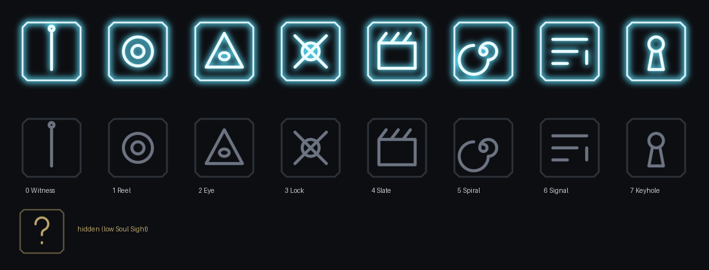
  - **UI mockups** (`SourceArt/UI_Mockups/ui_mockups.html`): the HALCYON Integrity Terminal (Key Lock with fragments, malware "UNVERIFIED SOURCE" rows, hidden glyphs, a notes row for the signature I find, Soul Sight meter); HALCYON Mail with the glyph signature footer; the employee badge HUD with task list, take number and 3 access-pass slots.
    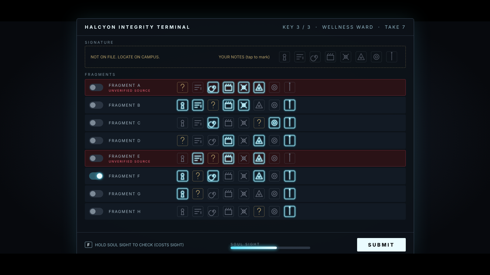
    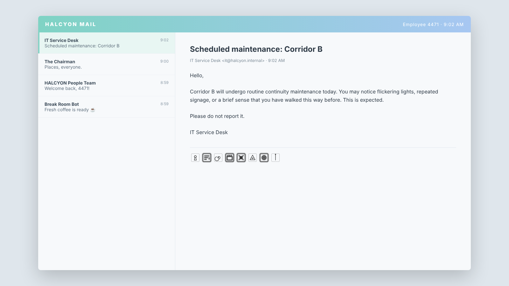
    
  - **Blueprint recipes** (`docs/BLUEPRINT_RECIPES.md`): Fear Director (+ editor slider preview), grab/throw/telekinesis, Corridor B loop teleport, stalker states + scaling, rewind on capture.
  - **Grey-box v2:** throwables (orange, physics on), loop posters + trigger, Wellness door blocker, nav mesh, and the **Hospital directly below the Wellness Center**. 181 actors.
    
  - **Fear materials script** (`Scripts/Editor/build_fear_assets.py`): `MPC_Fear` + `M_GreyboxFear` (clean → grimy, desaturated, damp, with noise so rot spreads unevenly) + colour-coded instances applied to the grey-box.
  - **11 placeholder SFX** synthesized from math (`SourceArt/Audio/Placeholder/`): clapper snap, PA chime, elevator ding, fluorescent buzz loop, glyph toggle, lock solved/wrong/corrupted, badge ok/denied, heartbeat loop. To be replaced by my own recordings.
- **Decisions & why:**
  - **Loop corridor only activates at Fear ≥ 0.5.** Claude caught that the teleport changes how far down the corridor you can see (end wall 7 m vs 17 m); fog and dim light at that Fear level hide it.
  - **Hospital under the Wellness Center** makes the trust fall a literal fall: no loading, just hide the floor.
  - **Orange = throwable** in the grey-box so it's obvious what can be grabbed while testing.
  - **Notes row on the Key Lock** so I can mark the signature I've pieced together from clues.
  - Small generated assets (UI textures, mockups, placeholder audio) are stored as normal git files, not LFS, because Claude's cloud workspace can't upload LFS.
- **AI tools used:** Claude (everything above; glyphs, mockups and SFX generated from code it wrote).
- **Next (tonight):** run both scripts → Fear Director recipe → 📸 Fear 0 / 0.5 / 1 screenshots.

### Session 19: Fri Nov 13, 2026, 15:27 MST: Getting ready to test tonight

- **Goal:** Remove as many manual steps as possible before I get home.
- **Done:**
  - Confirmed the project's default game mode is already `BP_FirstPersonGameMode`, so no World Settings step.
  - Read the plugin folder names in my UE 5.8 install and **enabled the plugins directly in `DirectorsCut_58.uproject`**: `PythonScriptPlugin`, `EditorScriptingUtilities`, `ModelContextProtocol` (Unreal MCP), `AllToolsets`. Old file backed up.
  - **`Scripts/Editor/preflight_check.py`:** checks all 40-ish Unreal features the builders depend on, starts the MCP server, generates `.mcp.json`, and writes `Saved/Take4471_preflight.txt` so Claude can read the results remotely.
  - **`Content/Python/init_unreal.py`:** starts the Unreal MCP server automatically whenever the editor opens.
  - **`docs/TONIGHT.md`:** the step-by-step for tonight, including how to connect Claude to the editor (Claude desktop app via an `mcp-remote` bridge, or Claude Code with the generated `.mcp.json`).
- **Decisions & why:**
  - **Preflight before building**, because the builder scripts were only tested against a stand-in for Unreal's API. The report pinpoints anything missing.
  - **Reports and logs land inside the project folder** (`Saved/`), which Claude can read, so debugging doesn't need me to copy and paste.
- **AI tools used:** Claude (plugin setup, scripts, runbook).
- **Next:** TONIGHT.md, steps 1–7.

### Session 20: Fri Nov 13, 2026, 15:32 MST: Production checklist

- **Goal:** One shared list so we both know what the game still needs.
- **Done:** `docs/PRODUCTION_CHECKLIST.md`, with ~75 tasks across setup, core systems, Acts 1–3 + ending, art, audio, polish, packaging/submission and record-keeping. Each has an owner (me / Claude / both), a target time, and a "done means" where it matters.
- **Decisions & why:**
  - **Checkpoints with fallbacks:** Fri 11 PM core systems · **Sat 2 PM Act 1 playable** · **Sat 10 PM whole game rough** · Sun 12 PM content freeze · Sun 2 PM packaged build · **Sun 5 PM submit**. Each says what to cut if we're behind.
  - **MVP definition:** TAKE 1 slate → wrap party in ~15 minutes, with a chase, three keys and the final choice.
  - Node.js and Git for Windows are already installed on the PC (seen in Program Files), so no downloads needed tonight.
- **AI tools used:** Claude (checklist, scheduling).
- **Next:** tonight's runbook; Claude keeps working down "Claude can do these any time".

### Session 21: Fri Nov 13, 2026, 15:39 MST: Writing, screens, posters

- **Goal:** Knock out the "Claude can do any time" list while I'm at work.
- **Done:**
  - **Writing** (`Data/Text/`): NPC lines now 30 (video call, meeting, frozen clocks, Act 3 trust circle, nurse agent, wrap-party lines incl. the unmasked stalker: *"Sorry about the chasing. You're really fast."*). New tables: `DT_PropText` (call sheet, whiteboard, agenda, plaque, signs), `DT_Ending` (17 beats: wrap party → Collector's offer → **Yes = THE THEATRICAL CUT / No = THE DIRECTOR'S CUT** → Sight flicker → black), `DT_Credits` ("Directed by" left blank).
  - **Screens** (`SourceArt/UI_Mockups/screens_mockups.html`):
    
    
    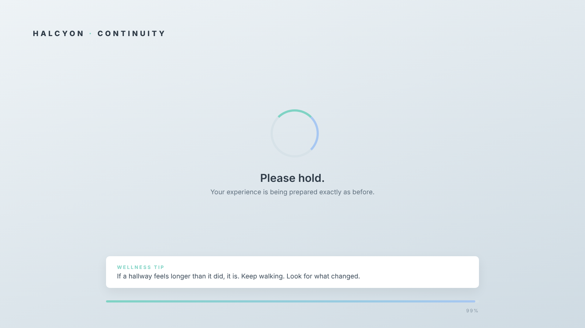
  - **Posters + portrait** (`SourceArt/Textures/Props/make_prop_textures.py`): 6 HALCYON posters, each with a `_Changed` twin that differs by one detail for the Corridor B loop, and the Chairman portrait, cropped at the chin.
    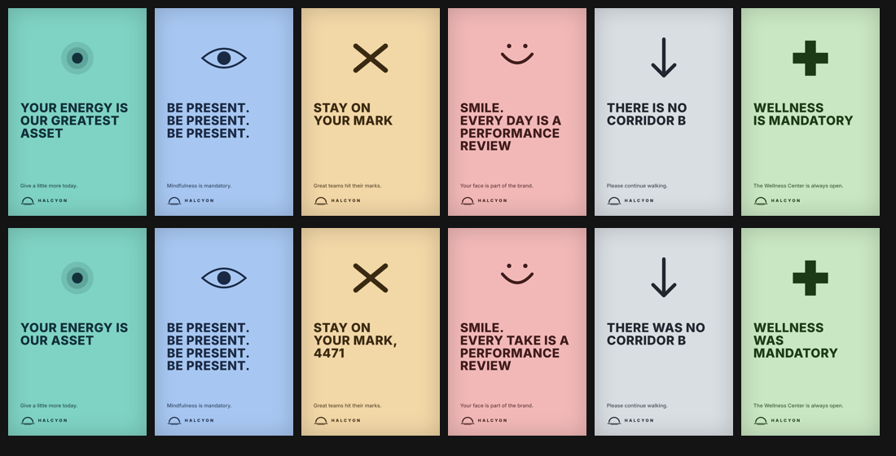
    
- **Decisions & why:**
  - **Title: TAKE 4471, subtitle "A Director's Cut"** (working title, can change).
  - **Loop posters change by one word** (IS → WAS, DAY → TAKE, an extra "BE PRESENT."): subtle enough to miss, obvious once spotted. Fits "solutions should be subtle and not easy to check".
  - **Ending branch titles shown on screen** (THE THEATRICAL CUT / THE DIRECTOR'S CUT) to land the theme.
  - The title screen says "Made with Unreal Engine" as text only; the real UE logo goes in per jam rules.
- **AI tools used:** Claude (writing; screens and textures generated from HTML/SVG code it wrote, rendered with headless Chrome).
- **Next:** tonight's runbook (TONIGHT.md).

### Session 22: Fri Nov 13, 2026, 15:45 MST: Office props + paper textures

- **Goal:** Real props instead of grey cubes, plus the last paper textures.
- **Done:**
  - **`SourceArt/Blender/make_office_props.py`** (Blender 5.2): builds 16 props procedurally with real-world sizes, floor pivots, bevelled edges and named material slots: desk, office chair, filing cabinets (4- and 2-drawer), monitor (screen has its own material slot for UI later), keyboard, mug, fire extinguisher, **director's chair**, water cooler, wet-floor sign, cubicle panel, ream of paper, **hospital bed**, mop bucket, coffee machine. Exports one FBX each + `OfficeProps.blend`. Claude ran it with Blender 5.2.4 (the `bpy` Python module) and rendered a preview:
    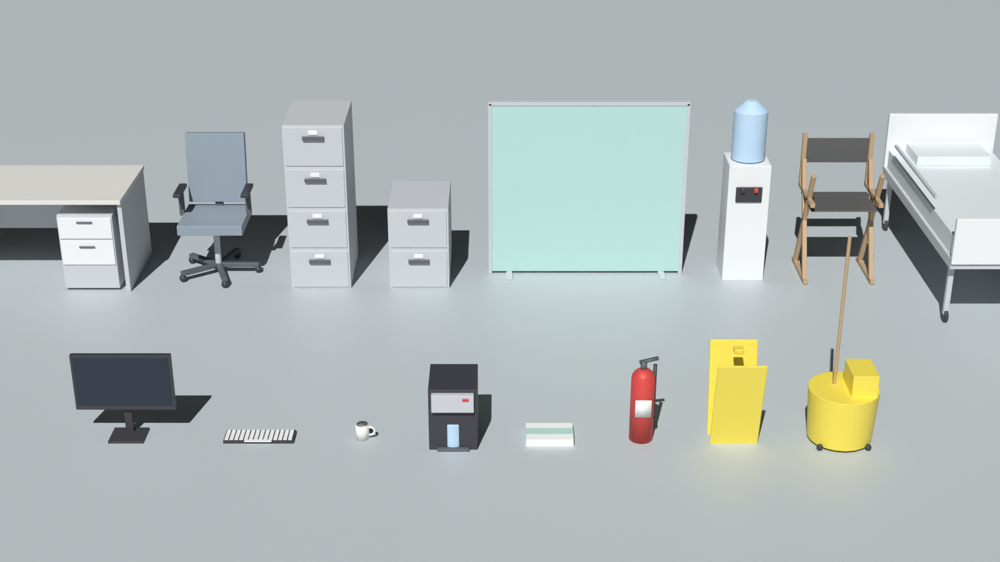
  - **Paper textures:** call sheet (take numbers 1–6 crossed out in red, 7 circled; "DO NOT LET 4471 SEE THIS SHEET") and 4 patient-chart script pages. Real pages have a **coffee ring** and say REV. WHITE; the fake is clean, REV. BLUE (the custodian's tip). Each has an empty **glyph strip** for the run's clue glyphs.
    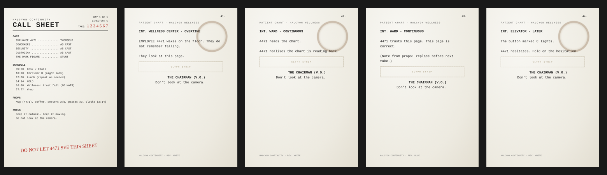
  - **`Scripts/Editor/import_jam_assets.py`:** imports all props, glyphs, posters/paper and placeholder sounds into tidy `/Game/...` folders; preflight now checks the importer's API too. Added as step 4b in TONIGHT.md.
- **Decisions & why:**
  - **Procedural Blender script instead of hand-modelling**: fast, editable by number, and repeatable. I'll polish hero props (and the Chairman portrait) later if there's time.
  - **Glyph strips left blank on paper** because clue glyphs come from the run seed.
- **AI tools used:** Claude (Blender script + test run + preview render, paper textures, import script).
- **Next:** TONIGHT.md.

### Session 23: Fri Nov 13, 2026, 16:03 MST: More props, a kitchen, and a bright office

- **Goal:** More things to throw, and a convincing bright corporate office: fake plants, design details, a kitchen.
- **Done:**
  - **Props: 16 → 49.** Office supplies (3 binders, stapler, tape dispenser, pen cup, desk lamp, desk phone, PC tower, laptop, copier, trash bin), fixtures (wall clock frozen at 2:14, pass reader, exit sign), bright design (tall fake ficus, desk succulent, lobby planter, mint sofa, coffee table, HALCYON sun logo, meeting chair), **kitchen** (counter with sink + wall cabinets, fridge with a memo, microwave, kettle, mint vending machine, café table, bar stool), **figures** (mint mannequin coworker, guard, custodian, and the too-tall, too-thin **stalker**).
    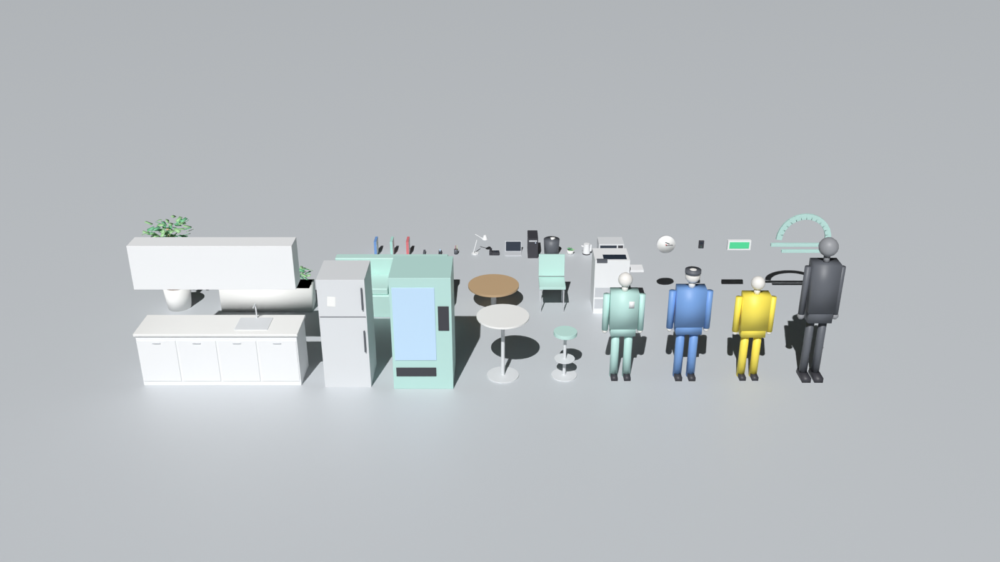
    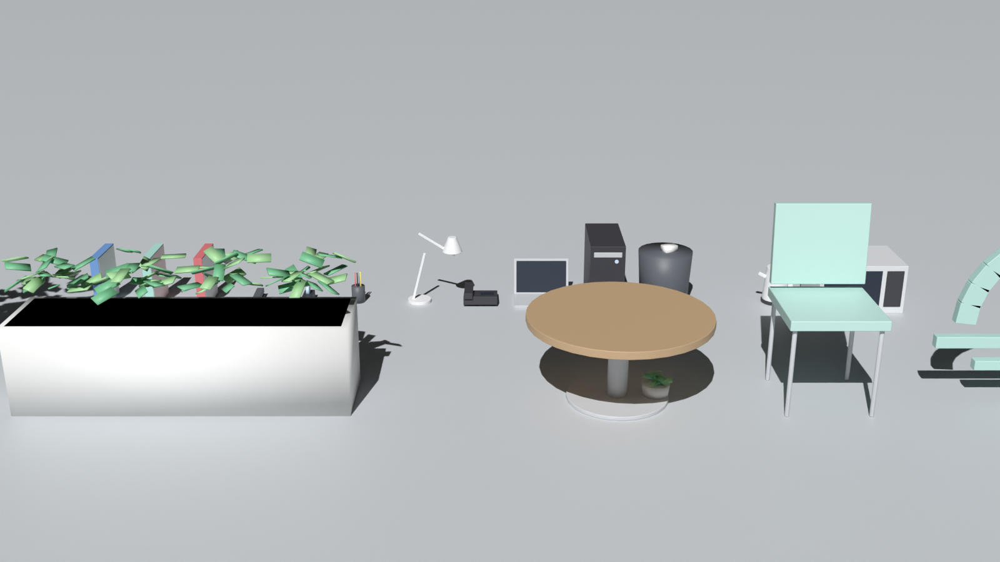
  - **`Scripts/Editor/dress_campus.py`:** replaces grey-box cubes with real props and furnishes every room: desk #4471 fully kitted out, 12 cubicles with seeded clutter, lobby, the break room turned **kitchen**, conference room, supply closet, Corridor B, Wellness Center and the Hospital ward. 208 props, **111 throwable** (physics + tag), 9 mannequins, director's chair hidden until Act 2.
  - Claude **assembled the dressed campus in Blender** from the same placement data to check for overlaps before tonight:
    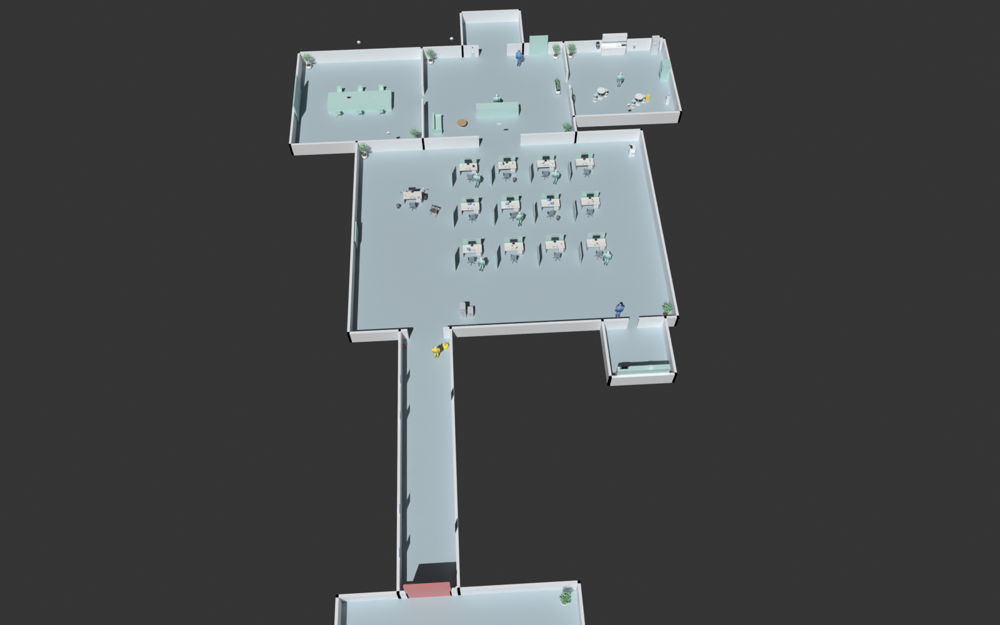
    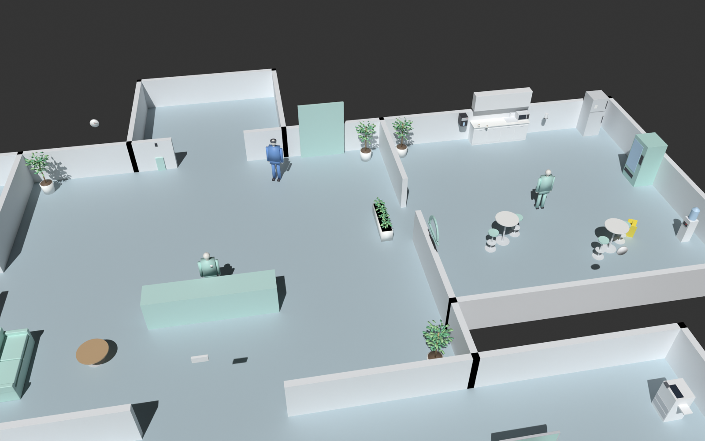
  - **`docs/ART_DIRECTION.md`:** HALCYON bright rules vs their Fear opposites (palette, light, plants, signage, people, sound, order), shape language, rooms at a glance, the throwables list.
- **Decisions & why:**
  - **Break room becomes the kitchen** (same room, no new geometry).
  - **Cubicle clutter uses a fixed seed** so the furniture is stable; the *run* seed varies clues and NPC agents, not furniture.
  - **Corridor B stays bare** past the entrance so the loop looks identical.
  - **YAW_FIX / SCALE_FIX knobs** in the dressing script, because how Blender's axes map into Unreal is only confirmed once imported.
- **AI tools used:** Claude (props script, dressing script, Blender layout check renders, art direction).
- **Next:** tonight: preflight → grey-box → Fear materials → import → **dress** → MCP.

### Session 24: Fri Nov 13, 2026, 16:19 MST: Gameplay core in C++

- **Goal:** Get gameplay first (art and design refine later). Build as much real gameplay as possible before I'm home.
- **Done:**
  - Checked the PC: **Visual Studio 2022 Community with MSVC 14.44** is installed, so the project can go C++.
  - **C++ module `DirectorsCut_58`** (~1,400 lines) staged in `Source_Pending/` so the Blueprint project keeps working until we switch it on:
    - `ATakeFearDirector`: one Fear value → MPC, post-process, fog, light flicker, letterbox; stage events; enables the loop at 0.5; wakes the stalker at stage 4; **previews in the editor**; auto-wires itself and **adds the grab component to the player**.
    - `UTakeGrabComponent`: E grab/drop, Right Mouse throw, telekinesis reach with a soul bit, heavy props need 3.
    - `ATakeLoopTrigger`: silent teleport loop, one poster swapped to its `_Changed` twin per loop, break by interacting with it.
    - `ATakeStalker`: Dormant → Stalk → Chase → Stunned; stunned by thrown props; catch triggers the rewind; speed scales with soul bits; `Slow()` for the extinguisher.
    - `UTakeRewindSubsystem`: "CUT. AGAIN.": fade, take +1, reset, back to desk #4471, one object changed.
    - `UTakeKeyLockLibrary` + engine-free `TakeKeyLockCore.h`: **tested here with g++ on 60,000 locks** (same results as the Python version).
    - `UTakeGameInstance`: run seed, take, soul bits/passes, and **console commands** (`TakeFear`, `TakeCreep`, `TakeStalker`, `TakeRewind`, `TakeLoop`, `TakeSoulBits`, `TakeSeed`) so everything can be tested before any UI exists.
  - Python updates: posters tagged `LoopPoster`, room lights tagged `FearLight`, PlayerStart tagged `Desk4471`; the importer now makes material instances for every poster/portrait/paper texture and dressing applies them; new `place_cpp_actors.py` spawns the C++ actors after compiling.
  - `docs/CPP_SYSTEMS.md` (what each class does, console commands, log lines) and TONIGHT.md step 6 (switch on C++, with instant undo).
- **Decisions & why:**
  - **C++ over Blueprint for the core:** Claude can write and partly test text code from the cloud; Blueprints can only be made in the editor. Blueprints are still how we'll do UI, tuning and one-off level scripting.
  - **Staged in `Source_Pending/`:** the first compile happens tonight; if it fails, nothing else is blocked.
  - **Auto-wiring everywhere:** fewer editor steps tonight = more time playing.
- **AI tools used:** Claude (C++ module, g++ tests, Python updates, docs).
- **Next:** TONIGHT.md: scripts → switch on C++ → first chase. 📸

### Session 25: Fri Nov 13, 2026, 17:35 MST: First build night: everything ran

- **Goal:** Run the whole TONIGHT.md chain on my PC.
- **Done:**
  - Opened `DirectorsCut_58`: Unreal MCP, All Toolsets and the Python plugin loaded; `init_unreal.py` started the MCP server automatically.
  - **Preflight: 52/52 PASS** (+ `.mcp.json` generated).
  - **All scripts ran clean:** grey-box campus built · Fear material on 158 actors · **95/95 files imported**, 18 prop material instances · **208 props dressed**, 70 placeholders replaced.
  - First script showed an auto-exposure warning (level too dark: no sun or sky). Claude wrote **`add_daylight.py`** (soft sun, sky atmosphere, real-time sky light, light fog, brighter room lights) and made the builder run it automatically.
  - **Switched the project to C++** (editor closed): `Source_Pending` → `Source`, module added to the `.uproject`, `TakeGameInstance` set, both maps start on `L_Campus_Greybox`, GameFeatureData asset-manager entry added. Backups in `_to_delete/backup_before_cpp/`.
  - **The C++ module compiled on the first try** (`UnrealEditor-DirectorsCut_58.dll`). Windows asked about .NET Host network access during the build (Unreal Build Tool); not needed.
  - Ran `place_cpp_actors.py` and pressed Play. Log: `Fear Director: MPC ok, volume ok, fog ok, 1 loop(s), stalker ok, 8 light(s)` · `Loop trigger: 6 posters` · `Added Take Grab to BP_FirstPersonCharacter_C_0`.
- **Decisions & why:**
  - **Level notes, different mannequins and refinements wait for polish.** Gameplay first.
- **Problems:** cosmetic import warnings (props have no UVs: "degenerate tangent bases"); fix in the Blender script before real materials.
- **AI tools used:** Claude (log reading, daylight script, C++ switch).
- **Next:** test Fear slider / creep / loop / stalker / grab / rewind 📸 → build Act 1 beats.

### Session 26: Fri Nov 13, 2026, 18:28 MST: Ceilings, panel lights, signs

- **My feedback:** the elevator and other areas were very bright, and in the main office you could look up and see the sun. We need an office ceiling, modern to fit the bright aesthetic. I couldn't find the kitchen.
- **Done:** `Scripts/Editor/add_ceilings.py`: flat white ceilings over every campus room; recessed linear LED panels on a 3 m grid (`M_CeilingPanel`, emissive, **dims with Fear**); 60 soft shadowless RectLights (40 tagged FearLight); Corridor B gets fewer, dimmer panels; hanging doorway signs (ELEVATOR, KITCHEN, CONFERENCE, OPEN OFFICE, LOBBY · KITCHEN, CORRIDOR B, SUPPLY, WELLNESS CENTER).
- **Decisions & why:**
  - The over-brightness was partly Claude's mistake: the daylight script had pushed room point lights to 20,000 cd. Those lights are removed; panels light the rooms now.
  - **Hospital ward has no ceiling slab** so the Act 3 trust fall from the Wellness Center can drop into it; its panels hang in the dark.
  - Builder now runs daylight + ceilings automatically on a rebuild.
- **AI tools used:** Claude (ceilings script).

### Session 27: Fri Nov 13, 2026, 18:32 MST: Wishlist batch 1 (level + art)

- **My wishlist:** sit at my desk and log into the terminal · planter blocks the kitchen entrance · lobby desk should say HALCYON + a company logo · open the fridge · stock the kitchen (snacks, coffee, tea) · snarky fridge note · microwave · pick up items · no default Unreal model · ambient noises · a janitor closet that opens/closes. Also: every chair faced the wrong way (a few can, not all), and mannequins should move around during the workday (working, checking email, getting coffee) and say random dialogue when you bump into them.
- **Done (batch 1):**
  - **Facing fix:** `YAW_FIX = 180` (Blender fronts arrive backwards in Unreal); 2 of 19 chairs turned the wrong way on purpose.
  - **Props 49 → 65, all with UVs now** (fixes the "degenerate tangent" warnings): reception desk, fridge body + **hinged** fridge door, door + frame, utility shelf, coffee bags, tea box, cup stack, snack bags/boxes, soda can, water bottle, milk carton, lunch box, fruit bowl.
  - **HALCYON logo** (half-sun mark + wordmark) + a wide mint panel for the reception desk front; **fridge notes**: a handwritten sticky (*"TO WHOEVER KEEPS TAKING MY YOGURT: I've seen every take. I KNOW it's you. - Accounting"*) and a People Team memo (*"Unlabelled items will be re-cast. Fridge clean-out is every Friday. It is always Friday."*). Call sheet re-rendered with real marker handwriting.
  - **Dressing:** planter moved out of the kitchen doorway; reception desk with logo, receptionist behind it; fridge door on its hinge with the notes attached (they swing with it) and food inside; kitchen counter stocked; **janitor closet** in the office's SW corner (walls, frame, hinged door, shelf, mop bucket, custodian). 240 props, 137 pick-up-able.
  - **Ambience:** 4 seamless placeholder loops (office room tone, fridge hum, lobby air + too-calm chord, Corridor B hum) + the fluorescent buzz, placed per room by `add_ambience.py`.
  - Fonts used in textures are open-licensed and listed as sourced in RESOURCES.md.
- **AI tools used:** Claude (props, textures, dressing, ambience).
- **Next:** batch 2 C++: interact (E: use or pick up), terminal/desk login with HALCYON Mail, openable doors/fridge, hide template arms, Fear debug keys, **wandering coworker mannequins with bump dialogue**.

### Session 28: Fri Nov 13, 2026, 19:06 MST: Wishlist batch 2 (C++ interaction, terminal, coworkers)

- **Goal:** make the office playable: one E key for everything, sit at desk #4471 and read mail, doors and fridge that open, no template arms, quick Fear keys, and coworkers who look busy and talk.
- **Done (C++, needs one rebuild):**
  - `UTakeGrabComponent` is now the player's hands. **E** = talk to a coworker / sit and log in at your desk / open or close a door or the fridge / pick up or drop a prop; **Right Mouse** = throw. A prompt under the crosshair says what E will do ("E  Pick up", "E  Open", "Too heavy"). Hides the template's arms and body. **1–4 / 0** set Fear 0.25 / 0.5 / 0.75 / 0.95 / calm (eases over 1.5 s).
  - Doors and the fridge swing on their hinge (eased, 0.6 s); the fridge notes swing with the door.
  - **Desk #4471:** you crouch into your seat facing the monitor, the cursor appears and **HALCYON Mail** opens (built in C++, no Widget Blueprint): inbox on the left, reader on the right, Act 1 emails from `DT_Emails` with `{EMP}` filled in. E or Tab logs out.
  - `ATakeCoworker`: the mannequins type at their desks (small lean, glancing between screens), get up every 8–25 s to visit a WorkSpot (coffee machine, fridge, water cooler, kitchen counter, printer, filing cabinets, lobby, office aisle), wait 4–10 s shifting their weight, and walk back. Bump into one or press E and a random line floats above its head. The receptionist and the guards stay at their posts; the closet custodian stays in the closet. Two coworkers are secretly agents (they get the uncanny lines). **Above Fear 0.75 they stop pretending:** they freeze and stare while you look at them, and creep closer when you look away. When Fear drops they walk back to their desks as if nothing happened.
  - 20 new Act 1 "Bump" lines in `DT_NPCLines` (coworkers, guards, custodians), e.g. *"Printer's jammed. It's fine. I'll stand here until it isn't."*
  - `place_cpp_actors.py` now also imports `DT_Emails` and `DT_NPCLines` as DataTables, places 8 WorkSpots and swaps the 11 NPC mannequins for coworkers (the dressed originals are hidden, so the script can be re-run). `dress_campus.py` tags your desk and monitor `Terminal` and keeps them off physics.
- **Decisions & why:**
  - Desk login lives in the grab component instead of a separate subsystem: one place handles E, so there's no fight over the key.
  - Coworkers are static mannequins moved by code (lean, bob, sway), no skeletal animation: fits "mannequin coworkers", and it's cheap to build in a jam.
  - Esc isn't used to log out in the editor because Esc stops Play in PIE.
- **Problems:** written without a compiler in the cloud; the first rebuild on the PC is the real test.
- **AI tools used:** Claude (C++ interaction system, coworker AI, UI, dialogue lines, scripts).
- **Next:** rebuild → re-run `dress_campus.py` + `place_cpp_actors.py` → playtest 📸 (screenshot of HALCYON Mail and a coworker talking) → answer the pick-up questions → Act 1 beats.

### Session 29: Fri Nov 13, 2026, 19:20 MST: More kitchen worktop

- **My feedback:** grabbed screenshots of the kitchen ("very good haha"), but a lot of the food was on the floor; we need more countertop. We'll also want sitting and standing animations the player and the NPCs can share, and later opening-the-fridge and grabbing animations (fine to wait).
- **Done:** two new props, `SM_KitchenCounterShort` (1.2 m with wall cabinets, fills the gap by the fridge) and `SM_KitchenIsland` (1.8 × 0.9 m). Re-laid the stock so every item sits on a worktop: the old layout had coffee bags and snacks past the ends of the 2.4 m counter, so physics dropped them. Moved the fridge WorkSpot out of the new counter.
- **Decisions & why:** an island instead of a longer counter: more surface, and something to dodge around when Fear is high.
- **AI tools used:** Claude (Blender props, layout).
- **Next:** rebuild results → shared sit/stand animation plan.

### Session 30: Fri Nov 13, 2026, 19:35 MST: First rebuild, frozen props

- **My feedback:** recompiled and ran the scripts. The Output Log filled with *"Trying to simulate physics on … but it has ComplexAsSimple collision"*, and in the kitchen the food hung in the air along the wall with no counter under it.
- **Screenshots:** 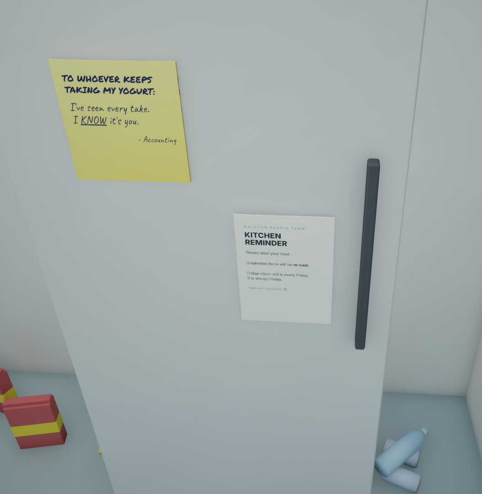 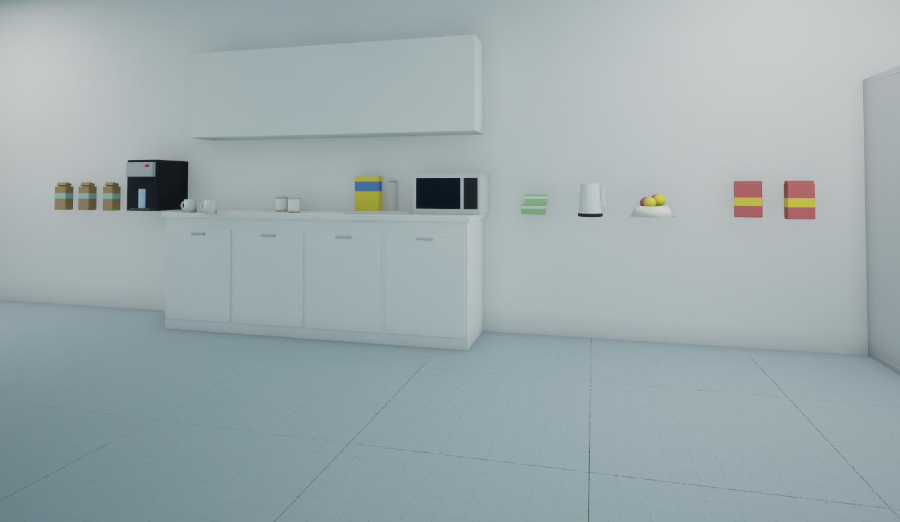
- **Cause:** the imported prop meshes only had their triangle ("complex") collision. Unreal can't run physics on that, so every pick-up-able prop froze where it spawned. The layout in the screenshot is also the old one: `dress_campus.py` ran before the island/short-counter update arrived.
- **Done:** `Scripts/Editor/fix_prop_collision.py` gives every prop a simple box collision and switches the pick-up-able ones (and the swinging doors) to use it; big furniture keeps exact collision so you can walk snugly around it. `import_jam_assets.py` now runs it automatically.
- **AI tools used:** Claude (log diagnosis, collision fix).

### Session 31: Fri Nov 13, 2026, 19:45 MST: Playtest 1 fixes

- **My feedback:** progress! (1) the ambience stops after one loop; (2) some kitchen and desk items float in the editor, then fall to the floor when Play starts; (3) E picks things up and drops them, but I'd like to throw them too; (4) I can't interact with coworkers.
- **Screenshots:** 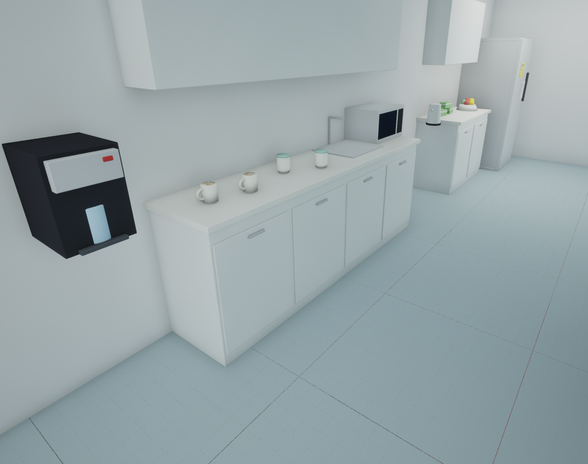 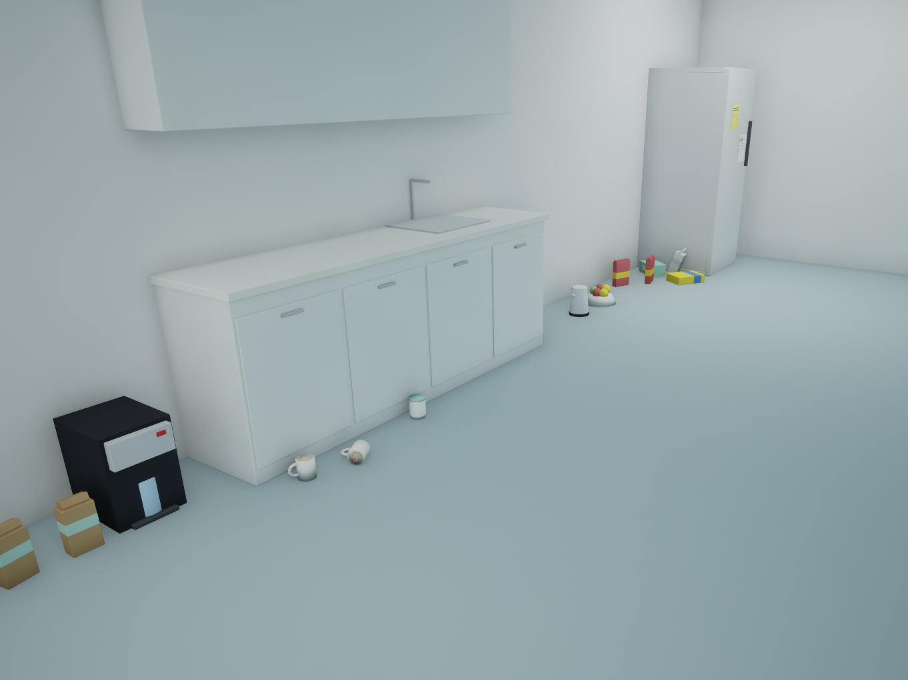
- **Causes and fixes:**
  1. Re-importing a sound resets its settings, so the loops lost "looping" when `import_jam_assets.py` ran again. The importer now re-sets looping on every `*_loop` sound and keeps them playing while you're out of earshot.
  2. Claude's measurement mistake: the counter is 2.4 m (240 cm) but the layout treated it as 4.4 m, so the coffee machine and kettle hung off the ends. The north wall is now one continuous run (short counter | main counter with sink | short counter | fridge), and every item is placed on a measured surface. Desk #4471's pen cup, phone and lamp were also just past the desk edge; moved in.
  3. Throw is now **left click** as well as right click while you're holding something (the prompt says "Click  Throw").
  4. Coworkers are Pawns, and Unreal's Pawn collision ignores the "what am I looking at" trace, so E never saw them. E now picks the coworker you're facing within 2.5 m. Their lines also appear as a **subtitle** at the bottom of the screen ("Coworker:  Printer's jammed…"), and the floating text is bigger and lower.
- **AI tools used:** Claude (diagnosis, C++ and script fixes).

### Session 32: Fri Nov 13, 2026, 20:45 MST: Why batch 2 didn't show up

- **My feedback:** the kitchen is fixed, and the fluorescent buzz in the hallway is great. But only right click throws (not left), and coworkers don't talk or show subtitles.
- **Cause:** the batch 2 C++ never compiled. The editor log still shows the old key message, `place_cpp_actors.py` stopped with *"unreal.TakeCoworker not found"*, and the module DLL was dated 18:22. Unreal only offers to rebuild when the module is missing or built for another engine version, not when the source changes. So reopening the project kept loading the old build.
- **Fix:** moved the old `UnrealEditor-DirectorsCut_58.dll` into `_to_delete/old_binaries`, so the next launch asks to rebuild. The collision fix worked: no more ComplexAsSimple warnings.
- **Lesson for the runbook:** after any C++ change, either remove the old DLL or build from Visual Studio / Live Coding. Reopening the project isn't enough.
- **AI tools used:** Claude (log reading).
- **20:48, first compile error:** `TakeCoworker.h(33): 'Role' ... already defined in scope 'AActor'`. Every Unreal actor already has a member called Role (for multiplayer), and Unreal won't allow a second one. Renamed ours to `NPCRole` (`npc_role` in Python). Also renamed a desk-login parameter that would have tripped the same check.

### Session 33: Fri Nov 13, 2026, 21:05 MST: It works! Compliance Training next

- **My feedback:** omg, the ambience and the NPCs talking add A LOT. I love that you can log into the computer now. Can we add the mandatory compliance training?
- **Done:** HALCYON Mail now has two tabs, **Inbox** and **Training (1 due)**. *Data Integrity Module 1* is the Key 1 tutorial in disguise:
  - Cheerful slides teach the XOR rule (glyph signatures, fragments, odd = lit / even = unlit).
  - **Practice:** a real Key Lock generated from this run's seed, with the signature, four fragments to switch on and off, and your live result in glyphs. "Next" appears only once it matches.
  - **Quick Check:** "Malware may disguise itself as a fragment. What should you do?" Picking *Look closer* gets "That answer is not on the list. Please choose again." and nudges Fear up a little. *Trust every fragment* is "Correct!"
  - **Final Question:** "Do you consent to your next take?" Both buttons say Yes. Then: *Module complete. Thank you for your consent. … There is nothing behind the walls.* A PA subtitle thanks you, and you earn **soul bit 1** (pass 1, telekinesis reach).
  - Progress is kept if you log out mid-module. Slides come from `DT_ComplianceTraining` (imported by `place_cpp_actors.py`).
- **AI tools used:** Claude (training module C++, Key Lock UI).
- **Next:** compile → playtest the module 📸 (the Key Lock slide is a great screenshot) → Act 1 flow: badge task list (check email, get coffee, complete training).

### Session 34: Fri Nov 13, 2026, 21:40 MST → overnight: dialogue, task list, rigged mannequin

- **My feedback:** "It is definitely coming along!" I'm getting sleepy, so let's plan tasks for the night. NPCs should cycle through different dialogue, and I like that the text appears above their heads.
- **Before bed, me:** kicked off a test **Windows package** overnight (packaging is the riskiest step; better to find problems on Friday than Sunday). Claude added the runtime-loaded folders (Data, UI, Props, Audio, Fear) to the cook list first, so emails, dialogue and glyphs make it into the build.
- **Done overnight (Claude):**
  - **Dialogue cycling:** each NPC greets you the first time, then cycles small talk shuffle-bag style (every line once before any repeat, never the same line twice in a row). After you've had coffee there's a 50% chance of a coffee comment, each said once. Lines are per role, and the receptionist now has her own. **75 lines** total (25 new).
  - **Act 1 badge task list** (top left): Check email · Get coffee · Complete Compliance Training. Opening the inbox ticks the first; **E at the coffee machine** pours a coffee (three different flavour texts) and ticks the second. All three done: the PA sends you to the 10:00 meeting in the Conference Room.
  - **Rigged mannequin (made from scratch in Blender):** 18-bone skeleton, articulated like a shop mannequin, with 3 variants (coworker / guard / custodian) sharing one skeleton and **6 animations**: Idle, Walk, SitDown, SitType, Reach, Stare. The pose directions are measured from the rig itself, so "forward" is forward on every limb. 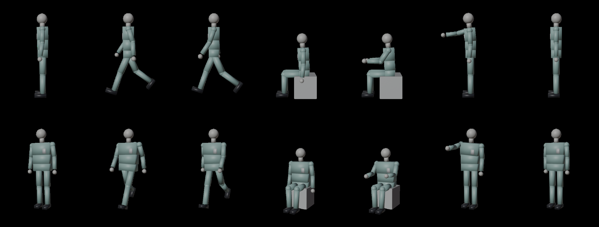
  - `import_characters.py` imports them as skeletal meshes on one shared skeleton; `import_jam_assets.py` runs it.
  - `docs/MORNING.md`: the exact run order for Saturday.
- **Decisions & why:**
  - Articulated (rigid-part) mannequin instead of a smooth skinned body: fits the "mannequin coworkers" look, and needs no weight painting, so it was reliable to build overnight without a person checking each joint.
  - One skeleton for every NPC (and later the player's seated camera), as you suggested: animate once, use everywhere.
  - Task list text uses plain [x] / [ ] marks: Unreal's default font may not have checkbox symbols.
- **AI tools used:** Claude (C++ dialogue + tasks, 25 dialogue lines, Blender rig + animations, pose preview renders, import script, runbook).
- **Next:** see `docs/MORNING.md`.

### Session 35: Fri Nov 13, 2026, 21:45 MST: Package started, pause menu

- **Me:** started packaging into `EpicJam/Builds/FridayNight`. We need a way to check your tasks in-game that also pauses, and an Escape menu to save, fix keyboard/audio settings and quit. Making tea, then another hour or so.
- **Package check (21:43):** the Windows game executable compiled (C++ ok for the shipping-style target); cooking is under way.
- **Done:** `UTakePauseMenu`, the **HALCYON break menu** (pauses the game):
  - **Tasks:** today's checklist, what's next, access passes 0–3, and when you last saved.
  - **Settings:** master volume slider (remembered between sessions); graphics Low / Medium / High / Epic; Fullscreen / Borderless / Windowed (both saved through Unreal's user settings); a controls reference.
  - **Save / Load:** one slot with take number, passes, training progress, tasks, the run seed (same seed = the same Key Locks after loading), Fear, and where you're standing.
  - **Quit to desktop.**
  - Opens with **P**, or **Esc** in the packaged game (in the editor Esc stops Play). P/Esc again or Resume closes it.
- **Decisions & why:** a controls *reference* now; real key rebinding (Enhanced Input user settings) is a polish-day task if there's time. Volume uses the engine's master volume, so it covers music, ambience and voices without extra sound mixes.
- **AI tools used:** Claude (pause menu, save system).
- **21:47: first package succeeded!** `Builds/FridayNight/Windows/DirectorsCut_58.exe`, 1.1 GB, Development build, AutomationTool exit code 0, compiled and cooked in about 7 minutes. The riskiest step of the jam has worked once on Friday night. 📸 a screenshot of the packaged game running goes in the devlog.

### Session 36: Fri Nov 13, 2026, 22:00 MST: The .exe works!

- **My feedback:** the packaged .exe works! There's just no way to exit without Ctrl+Alt+Delete. NPCs in the opening shouldn't need E to talk to most of them; their dialogue can just appear when you're near. And we can't show both the subtitle and the overhead text at once; we need to pick one (not sure which yet). The overhead text is cool, but it can get clipped. I also made a gameplay capture (`devlog/Recording 2026-11-13 215749_FirstBuild.mp4`, 31 s).
- **What the capture shows** (one frame per second): walking the open office (a coworker: *"Printer's jammed. It's fine. I'll stand here until it isn't."*), Corridor B with the custodian (*"Same scuffs every morning. Same exact scuffs."*), the Wellness Center door, then desk #4471 → HALCYON Mail with the real emails and the **Training (1 due)** tab, so the DataTables made it into the package. The overhead text is clipped at the top of the screen when you stand close to the custodian. The clip ends in Task Manager, since there's no Quit yet. 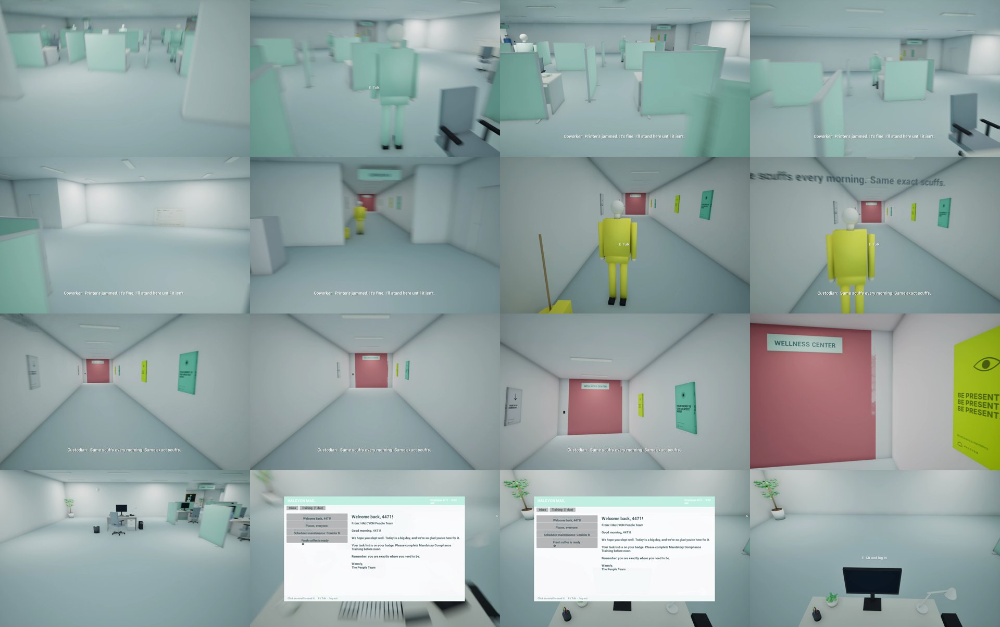
- **Done (waiting with the overnight C++):**
  - **NPCs talk when you walk past** (within ~2.6 m, in line of sight, no E). Only one NPC talks at a time; each waits 18–35 s before talking on its own again. Bumping into someone or pressing E still gets a line right away.
  - **Dialogue display is a setting** (pause menu → Settings → Dialogue), so we can try both and decide: **Subtitles** (default; a small "..." floats over whoever is talking) · **Over their heads** · **Both**. Saved between sessions.
  - **Overhead text no longer clips:** wraps at about 26 characters per line, sits just above the head, and scales with distance so it stays about the same size on screen.
  - Lines stay up longer when they're long (about 14 characters a second).
  - Exiting: the pause menu (P / Esc) has **Quit to desktop**. It arrives with the morning rebuild.
- **AI tools used:** Claude (video frame review, C++).

### Session 37: Fri Nov 13, 2026, 22:15 MST: Feel like a game: story NPCs, seated coworkers, coffee sips, locked doors, HUD

- **My feedback:** we have a good starting place, but the game hasn't *progressed* yet; let's keep going and see if overnight runs can be scheduled. It needs more game-like elements (HUD and so on). Also: (1) keep E-to-talk for story/quest characters only; office NPCs just talk as you pass. (2) The janitor, badge guard, front desk and security should be stationary. (3) Some coworkers should sit working at their desks. (4) Pick up your coffee and sip it, with slurping noises. (5) Try doors like the janitor closet and hear them locked. (6) Anything else from the video?
- **Done:**
  1. **Story NPCs only for E.** The receptionist, the closet guard and the closet custodian show a mint **"!"** and say "E  Talk"; everyone else just talks as you pass.
  2. Receptionist, both guards and both custodians are **stationary**.
  3. **Four coworkers sit at their cubicles typing**, the first use of the rigged mannequin (sitting/typing animation). Standing coworkers now **walk** with the walk cycle, idle at the coffee machine, and **stare** at high Fear. If the rig isn't imported, everyone falls back to the old static mannequin. `import_characters.py` renames the animations `AS_Idle / AS_Walk / AS_SitType / AS_Stare / …` so the code can find them.
  4. **Sip your coffee:** hold a mug and press **F**. The mug comes up to your face and tips, *slurp* (new sound), and a line: "*slurp* Tastes like Monday." / "…Is it getting fuller?" Before you've poured a coffee it's "It's empty. The coffee machine is in the kitchen." Pouring now plays a pour sound.
  5. **Locked doors:** the janitor closet needs **access pass 1**. Without it the handle rattles (the door jiggles, new rattle-and-thunk sound) and you get "Locked. Access pass 1 required." Finishing Compliance Training gives you pass 1. Then "Access pass accepted." and it opens, with door open/close sounds. **This is the first real progression gate.**
  6. **HUD:** a small crosshair dot; top right, **a clock** (starts 9:00 AM; one game minute every 3 s; **it stops at 11:59 until your morning tasks are done**, because it's always almost noon) plus **TAKE n · PASS n / 3**.
- **From the video (6):** motion blur was heavy when turning, so it's off now (`DefaultEngine.ini`). After logging out the camera was left looking up/down; now it levels out. Overhead clipping and no Quit were fixed last session.
- **New sounds (placeholders, synthesized):** `sfx_sip_slurp`, `sfx_door_locked`, `sfx_door_open`, `sfx_door_close`, `sfx_coffee_pour`.
- **AI tools used:** Claude (C++, sound synthesis, scripts, video review).
- **Overnight scheduled runs (22:17):** two one-off scheduled Claude runs, briefed by `docs/OVERNIGHT_BRIEF.md`. They work on their own git branches and stage files on the PC under `_to_delete/`, never in `Source/`, so nothing breaks the project while you sleep. Both run with automatic approval.
  - **Run 1, 00:45:** Act 1 progression: objectives on the HUD, the cold open (`TAKE 1`, PA "Good morning, team"), multi-line story NPC conversations, morning complete → 10:00 meeting slip → Corridor B wisp → loop break. Branch `overnight-run1`.
  - **Run 2, 03:15:** compile-readiness review of everything new, then beat 1.10 (clock jumps to 12:00, "Lunch is served.", Act 2 task list) and, if time allows, the repeating PA and clocks frozen at 2:14. Branch `overnight-run2`.
  - Morning: Claude reviews both branches, merges, copies into the project, rebuild.

### Session 38: Fri Nov 13, 2026, 22:30 MST: Sitting fix, story NPCs wait for E

- **My feedback:** I love the coffee sipping. Found a sitting error (screenshot). Also, when you press E on a story character like the badge guard, the subtitles should start *after* you press E. 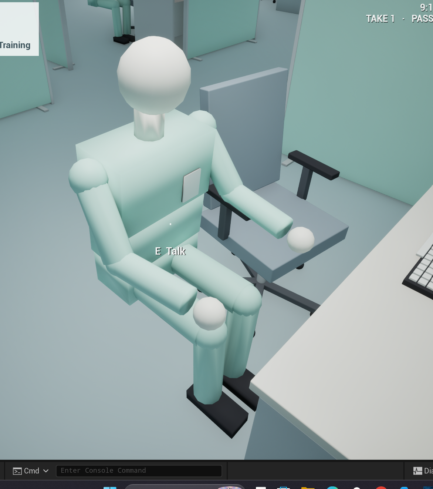
- **Cause:** the seated coworker was spawned inside the chair's collision, so at Play the character physics pushed it out, and it sat in mid-air in front of the chair. Its chair could also be one of the deliberately backwards "WrongWay" chairs. The screenshot also showed "E  Talk" on an ordinary coworker: the look-at trace still counted every coworker, not just story characters.
- **Fixes:**
  - Seated coworkers no longer use walking physics or get pushed by furniture (they still block you). Their chair is squared up to the desk, held still, and the coworker is placed so the hips land on the seat.
  - **Facing knob:** if a rigged mannequin faces the wrong way, `MeshYaw` (default -90) on the coworker fixes it. In Play you can test on everyone with the console command `TakeNPCYaw 90` (or 0 / 180 / -90).
  - **Story characters (receptionist, closet guard, closet custodian) only talk when you press E**: no proximity or bump lines. Ordinary coworkers never show "E  Talk".
- **AI tools used:** Claude (screenshot diagnosis, C++).

### Session 39: Fri Nov 13, 2026, 22:50 MST: Sound you can feel

- **Me:** time for one more round of compiles.
- **Checked:** session 38 compiled cleanly; the log shows "Seated 4 coworker(s)" and 3/3 DataTables.
- **Done:** footsteps (4 variations, never the same one twice in a row, slight pitch change each step; quieter when crouched/seated), a pick-up tick, a throw whoosh, and **impact clunks** when a thrown or knocked prop hits something (light / heavy by mass, louder the faster it was going, quiet for the first 2 s while props settle). New placeholder sounds: `sfx_step_1–4`, `sfx_pickup`, `sfx_throw`, `sfx_impact_light`, `sfx_impact_heavy`.
- **AI tools used:** Claude (sound synthesis, C++).

### Session 40: Fri Nov 13, 2026, 23:00 MST: Softer steps, phones that ring

- **My feedback:** I preferred soft clicking steps over the knocking ones, but that can wait. I love the throwing sounds! Keep the subtle phone sound from before. Maybe the telephone can ring and you can pick it up?
- **Done:**
  - **Softer footsteps:** short soft clicks (office shoes on vinyl) instead of thuds, and quieter. Easy to swap for real recordings later.
  - The distant phone trill is still in the office room tone (it never went away). The ambience had stopped looping, which is why it seemed to disappear.
  - **Phones ring and you can answer them.** About 45 s in, **your desk phone rings** (classic double trill, four rings, then it gives up). **E: "Answer the phone."** Your calls go in order: a HALCYON automated wellness check ("…You are exactly where you need to be."); "…is this take four? No. Four-four-seven-one. Sorry. Wrong take."; heavy breathing, "…Places."; and "Hi. It's you. From later. Don't trust the fragments. Look closer." (Fear creeps up a little). Every 1–2 minutes a phone rings somewhere on the floor: other people's phones give wrong numbers, hang-ups or a dial tone. Lines play as a subtitle sequence.
  - New sounds: `sfx_phone_ring`, `sfx_phone_pickup`, `sfx_phone_dialtone`; softer `sfx_step_1–4`.
- **AI tools used:** Claude (sound synthesis, C++, phone call writing).
- **23:05, my feedback:** the phone rings, but there was no way to answer it. E should answer if the phone is ringing at your desk: pick up, some subtitles and static for now. Real voices tomorrow.
- **Fix:** the desk and monitor ("Sit and log in") were winning the look-at check over the small phone. Now a ringing phone within reach wins whenever you're roughly facing it. Sitting at your terminal, **E answers the ringing phone** instead of logging you out. Answering plays the pick-up click plus **line static** (`sfx_phone_static`, 6 s) under the subtitles. Phones can also ring while you're seated.

### Session 41: Fri Nov 13, 2026, 23:25 MST: Look closer, walking-pace steps

- **My feedback:** we should be able to inspect the director photo. I like the walking sound, but it should be at walking pace; it's too rushed. There are other little things, but we need to work on a lot more gameplay first. Exciting stuff!
- **Done:**
  - **E: "Look closer"** on the Chairman's portrait, the call sheet, the Corridor B posters and the fridge notes: the picture fills the screen with a title and a caption (the Chairman: *"Founder. Visionary. Always just out of frame. The plaque says he's proud of you. It doesn't say for what."*). It shows whatever the board shows *right now*, so a poster that changed in the loop looks changed: *"Wasn't it different a minute ago?"* E / Esc / click puts it back.
  - **Footsteps at walking pace:** timed steps (about 2 a second when walking, a little quicker running, slower crouched) instead of one every 78 cm.
- **Note:** agreed, gameplay first. The overnight runs are focused on Act 1 progression.
- **AI tools used:** Claude (C++, captions).

### Session 42: Sat Nov 14, 2026, 00:45 MST: Overnight run 1, Act 1 progression (branch `overnight-run1`)

- **Goal (docs/OVERNIGHT_BRIEF.md, Run 1):** after the morning tasks, give the player a clear thread to the first scare and the first soul energy: objectives on the HUD, the cold open, real conversations with the story NPCs, the 10:00 meeting slip, Corridor B, the wisp.
- **Who:** scheduled Claude run while I slept. Nothing has been compiled yet; all of this is on the `overnight-run1` branch, not `main`, and nothing was copied into the PC project.
- **Done:**
  1. **Objectives.** `UTakeGameInstance::Objective` + `SetObjective()` (and `OnObjectiveChanged`), and a story beat `ETakeBeat` (Morning → Meeting → Corridor → ReturnToDesk). The badge panel shows `NEXT · <objective>` under the task list; when it changes there's a soft badge ping and a queued subtitle *"New objective: …"* (it waits for the line already showing). The pause menu's Tasks page shows it too. Objectives: *Check in at Reception (Lobby)* → *Finish your badge tasks before noon* → *Attend the 10:00 meeting (Conference Room)* → *Something is at the end of Corridor B.* → *Return to your desk.*
  2. **Cold open (beat 1.1).** Play starts black; the clapper snaps; **TAKE n** in big white letters for about 2 s; fade in at your desk; PA chime + *"Good morning, team. The Chairman thanks you for your energy."*; then the first objective. The Fear Director also fades the camera from black so the first fraction of a second isn't visible before the HUD exists. Bonus: when the stalker catches you, the rewind's black now shows **"CUT. AGAIN."** then **TAKE n**, and the PA says *"Thank you for your patience. We are going again from the top."*
  3. **Story NPC conversations.** E on the receptionist, the closet guard or the closet custodian pages through a conversation, one line per press (prompt: **E  Continue**). The "!" over their head only shows while there's something new to hear, and comes back when a new conversation unlocks. Lines are in `DT_NPCLines` with Context `Story1, Story2…`; `Pass1Story…` once you hold pass 1; `DoneStory…` once the morning is done; `SlipStory…` after the slip (22 new lines, in `make_text_tables.py`). The receptionist gives the **morning brief** (email, coffee, training, then the 10:00), and hearing it moves the objective on. The guard does a badge check ("Access pass 1, or you don't go in"). The custodian: *"Don't go in my closet"* until pass 1, then the hum in Corridor B and *"One of them's always new. Look closer at that one."* Story rows never leak into anyone's small talk.
  4. **Morning complete → the slip (1.5–1.6).** Finishing all three tasks keeps the existing PA line and sets the objective to the 10:00 meeting. Walking into the Conference Room (new `TakeBeatTrigger`): the lights flicker hard (`FearLight`), Fear creeps to 0.35, *"…Where is everyone?"*, objective *"Something is at the end of Corridor B."* Entering Corridor B: PA *"Corridor B is perfectly safe. Please continue walking."* and Fear creeps to 0.55.
  5. **The loop only runs during this beat.** The Fear Director now allows the Corridor B loop only in the Corridor beat (from Fear 0.3, `BeatLoopFear`), or when forced with `TakeLoop 1`. Before, it switched on whenever Fear passed 0.5. **Breaking the loop finally works:** *Look closer* at the poster that changed and the loop breaks (*"That's the one… Somewhere ahead, the hum stops."*). Nothing called `TryBreakLoop` until now. Hints after loop 1, 2 and 4. If the `_Changed` poster materials are missing, the loop lets you through after 3 laps so you can't get stuck.
  6. **The wisp (1.8a).** New `ATakeWisp`: a glowing mint sphere with a point light, bobbing and pulsing, at `GB_SoulEnergy_Act1` (end of Corridor B, past the loop). It's only there during the Corridor beat. **E: "Reach for the light"**: Fear drains to 0, a flag is set, objective *"Return to your desk."*
  7. **Placement:** `place_cpp_actors.py` now also places `CPP_Beat_ConferenceRoom`, `CPP_Beat_CorridorB` and `CPP_Wisp_Act1`, and creates the `/Game/Fear/M_Wisp` emissive material once. If the new classes aren't compiled it warns and carries on.
  8. **Save/Load** keeps the beat, the objective, the morning brief and the wisp. Older saves still load (they start at Morning and move on if the tasks are done).
  9. **Console:** `TakeBeat 0/1/2/3` jumps to a beat (1 = all morning tasks done, go to the meeting; 2 = Corridor B; 3 = after the wisp).
- **Files:** new `TakeStory.cpp` (the story half of `UTakeGrabComponent`, in its own file to keep the diff readable), `TakeWisp.h/.cpp`, `TakeBeatTrigger.h/.cpp`. Changed: `TakeGameInstance`, `TakeGrabComponent`, `TakeCoworker`, `TakeFearDirector`, `TakeLoopTrigger` (`ForceBreak`), `TakeWidgets` (slate on the HUD), `TakePauseMenu`, `TakeSaveGame`, `make_text_tables.py` + `DT_NPCLines.csv`, `place_cpp_actors.py`.
- **Decisions & why:**
  - Story logic lives in the grab component, which already owns the HUD, subtitles and sounds; adding a separate story manager would have meant more wiring that could break on first compile. It's in `TakeStory.cpp` so the big file barely grows.
  - Trigger boxes (`TakeBeatTrigger`, a name + a box) instead of hard-coded room bounds in C++, so we can move them in the editor and reuse them for Act 2.
  - The loop switches on at Fear 0.3 during the beat (not 0.5), so you can't sprint past the loop box before Fear catches up. Fog is lighter at 0.35–0.55; the repeated corridor sections are identical, so it should still be hard to spot the teleport. Worth watching in the playtest.
  - Training is still a morning task (it already gives pass 1), so the wisp comes *after* training, not before as in storyboard 1.9. Run 2's beat 1.10 is written for this order ("after the wisp and training").
  - The wisp is found by facing it within about 3 m, like coworkers, because a small bobbing sphere is fiddly to hit with the look trace.
- **Uncertain (check at compile):**
  - Not compiled. The things I'm least sure about: `Glow->IntensityUnits = ELightUnits::Lumens` set in the wisp constructor; `FSlateFontInfo::LetterSpacing` on the slate text; the `Count UMETA(Hidden)` entry at the end of `ETakeBeat`. Each is a one-line fix if it fails.
  - Box positions come from `build_greybox_campus.py` (Conference Room centre 750, 1100; Corridor B entrance 1400, 3780). If the level was moved since, drag `CPP_Beat_*` into place.
  - `M_Wisp` is created by Python (`MaterialEditingLibrary`); only tested against a mock `unreal` module in the cloud, not in Unreal. If it fails, the wisp still shows as a white sphere with a mint light.
  - No new sounds: reused `sfx_clapper_snap`, `sfx_pa_chime`, `sfx_badge_ok`, `sfx_lock_solved`. The slip has no sound sting yet.
  - The device bridge had no connected folder tonight, so nothing is staged under `_to_delete/overnight_run1/`. The branch is the only copy.
- **Not done (left for later):** the stalker in Corridor B (beat 1.7: Fear stays under 0.9 here, so it doesn't wake); the involuntary Soul Sight flicker (1.5); anything after "Return to your desk" (Run 2, beat 1.10).
- **AI tools used:** Claude (scheduled overnight run: read the brief, devlog, storyboard and C++; wrote the C++, dialogue lines, placement script and docs; ran `make_text_tables.py`; ran `place_cpp_actors.py` against a mock `unreal` module to catch script errors).
- **Next:** morning merge + compile (`docs/MORNING.md`), then play from the cold open to the wisp. 📸 the **TAKE 1** slate, the flickering Conference Room, and the wisp at the end of Corridor B go in `devlog/screenshots`.

### Session 43: Sat Nov 14, 2026, 03:15 MST: Overnight run 2, review + beat 1.10 + the Act 2 doorway (branch `overnight-run2`)

- **Goal (docs/OVERNIGHT_BRIEF.md, Run 2):** (1) check every line of C++ written since `main` (run 1's branch, plus session 41's inspect code, which may not have been compiled yet) against the hard rules, and fix what I find; (2) beat 1.10, lunch and the Act 2 task list; (3) if there's time, the repeating PA (2.1) and the clocks freezing at 2:14 (2.6).
- **Who:** a scheduled Claude run while I slept. Nothing has been compiled. Everything is on `overnight-run2`, which is built on `overnight-run1` (so it includes run 1). Nothing was copied into the PC project.
- **Review (run 1 + session 41):** I read every changed header and .cpp, looking for UHT name clashes with parent classes, locals shadowing members (I also ran a rough script over all the classes), missing includes, UE 5.8 signatures, null checks and non-ASCII string literals. I found no definite compile errors. Fixed:
  1. `FindFearDirector()` was a `for` loop that returns on its first pass (MSVC can warn "unreachable code" here). Now it's a plain iterator check.
  2. **Bug:** `ShowSubtitleSequence()` (phone calls) *replaced* the subtitle queue, so a queued "New objective: …" cue was lost if a phone call started. Now the call goes first and the queued lines play after it.
  3. A literal `·` (non-ASCII) in the pause menu title → `·` (hard rule 1).
  - Checked and believed fine: `ETakeBeat::Count UMETA(Hidden)`, `FSlateFontInfo::LetterSpacing` (int32), the `const FString&` dynamic delegate, `UFUNCTION` parameter names (`Count`, `NewTakeNumber`, `HHMM`: no parent clashes), `TObjectPtr` used in bool contexts, `StartCameraFade` arguments, `GetTextureParameterValue(FMaterialParameterInfo, UTexture*&)`, `UImage::SetDesiredSizeOverride`, `UUserWidget::SetIsFocusable`.
  - **Still not sure:** `Glow->IntensityUnits = ELightUnits::Lumens` in the wisp constructor (public in 5.4–5.6; if 5.8 made it private, use `Glow->SetIntensityUnits(ELightUnits::Lumens)`). This is the only line I'd bet on failing.
- **Built:**
  1. **Beat 1.10, back at your desk.** After the wisp (beat `ReturnToDesk`), with training done, walking back within ~2.6 m of desk #4471 (tag `Desk4471`, else `Monitor4471`, else the `Desk4471` PlayerStart) starts lunch: a short black blink + clapper (a jump cut), *"...Twelve? It was eleven a second ago."*, **the clock jumps to 12:00**, PA chime + **"Lunch is served."** It doesn't fire while you're logged in at the terminal (the terminal covers the subtitles); it plays when you stand up. New beat `ETakeBeat::Lunch` = Act 2 (`CurrentAct()`).
  2. **Act 2 task list (beat 2.2)** on the badge and in the pause menu, under a "MIDDAY" header: Join 12:30 call · Attend 1:00 meeting · Check in with 3 coworkers (n/3) · Reply to the Chairman. The objective follows the first unfinished one (*"Join the 12:30 call (Conference Room)"*). Both lists are now built in one place (`UTakeGameInstance::TaskListText`).
     - **Check in with 3 coworkers works now:** the receptionist, the closet guard and the custodian each have a 3-line `LunchStory` conversation (the "!" comes back at lunch). Finishing each one = 1/3. The custodian warns you about the clocks and the mannequins.
     - **The 12:30 call, the 1:00 meeting and the reply aren't built yet** (beats 2.3–2.4). Walking into the Conference Room at lunch gives one honest placeholder line: *"The screen says: SYNC (12:30). Waiting for the organizer…"*.
  3. **Repeating PA (beat 2.1):** "Lunch is served." plays word for word three times, 6.5 s apart (*"...Didn't they just say that?"* after the third), then comes back every 2–3½ minutes all through Act 2, sometimes as a triple again. It waits while you're seated, inspecting or paused. Tunable on Take Grab → Story.
  4. **Frozen clocks (beat 2.6):** in Act 2 the HUD clock runs from 12:00 and **stops at 2:14 PM for good** (about 6½ real minutes, 1 min / 3 s as before). The lights flicker, PA *"The time is two fourteen. The time is two fourteen."*, *"The second hand isn't moving. None of them are."*, Fear creeps to 0.25 and **never drops below 0.15 again** in Act 2 ("Fear begins faster"). The wall clock meshes don't have hands to stop, so it's the HUD clock + text for now.
  5. **The world catches up:** coworkers switch to Act 2 small talk at lunch (8 new lunch lines + the existing Act 2 ambient/hint/clue lines; scene-only lines like the video call's are kept out), and the "two fourteen" line only once the clocks have frozen. The terminal shows the real time in its header and gets **Act 2 mail on top**: *Lunch is served* and the 12:30 invite at lunch; Facilities' *Re: the clocks* now arrives when the clocks freeze (was "AfterMeeting").
  6. **Save/Load** keeps the clock and all Act 2 state. Old saves load with the clock at 9:00.
  7. **Console:** `TakeBeat 4` plays beat 1.10 right away (Act 2); `TakeTime 1410` sets the clock (in Act 2 that's 12 s before the freeze).
- **Files:** `TakeStory.cpp` (Act 2 doorway section), `TakeGrabComponent.h/.cpp` (clock, tasks, subtitle queue fix), `TakeGameInstance.h/.cpp` (beat `Lunch`, Act 2 flags, task list, `TakeTime`), `TakeCoworker.h/.cpp` (act-aware lines, `Lunch` conversations), `TakeWidgets.cpp` (terminal mail + clock), `TakePauseMenu.cpp`, `TakeSaveGame.h`, `make_text_tables.py` → `DT_NPCLines.csv` (116 lines, +19), `DT_Emails.csv`. No new classes, so there's nothing new to place in the level.
- **Decisions & why:**
  - "Check in with 3 coworkers" uses the three story NPCs, the only characters with E-conversations. The malware-agent false clue (beat 2.5) can sit on top of this later.
  - The desk is found by its tag, not a new trigger box, so there's no editor step.
  - The jump to 12:00 is a hard cut (black blink + clapper) rather than a fast-forward: missing time fits *Director's Cut*.
- **Risks:** not compiled (see "still not sure" above). 2:14 arrives ~6½ min after lunch; if Act 2 needs longer, raise the 3 s per minute or move `FrozenClockMinutes`. The PA repeating every 2–3 min may get annoying: `LunchPAGapMin/Max`.
- **Not done:** beat 2.3 video call / 2.4 meeting / the reply to the Chairman (the tasks are listed but can't be ticked yet); mannequins turning to face you (2.6); real wall-clock hands; the device bridge had no connected folder again, so nothing is staged under `_to_delete/overnight_run2/`.
- **AI tools used:** Claude (scheduled overnight run: code review of runs 1 + session 41, C++, 19 dialogue lines, an email re-timing, docs; ran `make_text_tables.py`; a small Python script to look for shadowed names).
- **Next:** morning merge + compile (`docs/MORNING.md`), then play from the wisp to 2:14. 📸 the 12:00 jump with the Act 2 task list, and the frozen 2:14 clock, go in `devlog/screenshots`.

### Session 44: Sat Nov 14, 2026, 08:35 MST: Good morning: merging the overnight runs

- **Me:** good morning! Thanks for running last night. (Fable is included in my plan for 3 more days, which covers the jam.)
- **Both overnight runs finished** and pushed their branches (`overnight-run1` 00:45, `overnight-run2` 03:15). The device bridge wasn't connected for them, so nothing was staged on the PC; the branches were the only copy, as designed.
- **Merged:** `overnight-run2` (which contains run 1) fast-forwarded into `main`. 26 files, +1,415 lines.
- **Pre-emptive fix:** run 2 flagged one line as likely to fail (`Glow->IntensityUnits = …` in the wisp); switched it to `Glow->SetIntensityUnits(ELightUnits::Lumens)`, the public setter.
- **Next:** copy into the PC project, rebuild, run the scripts, play the morning from the cold open through lunch to 2:14.

### Session 45: Sat Nov 14, 2026, 09:10 MST: First full playthrough to lunch, big feedback round

- **Compiled first try** (the overnight runs' 1,400 lines plus my fixes). I played from the cold open through the slip, Corridor B and the wisp ("that transition is amazing!!!!") to lunch, and recorded it (`devlog/Recording 2026-11-14 085508_secondact.mp4`, 5:26). 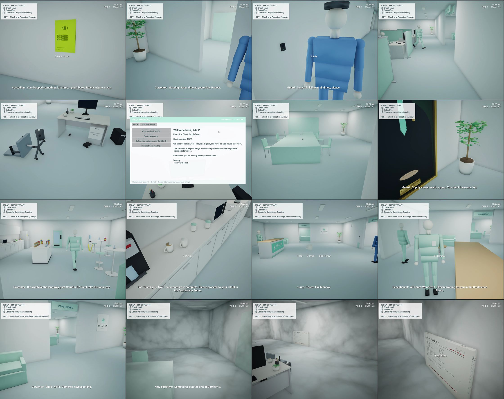 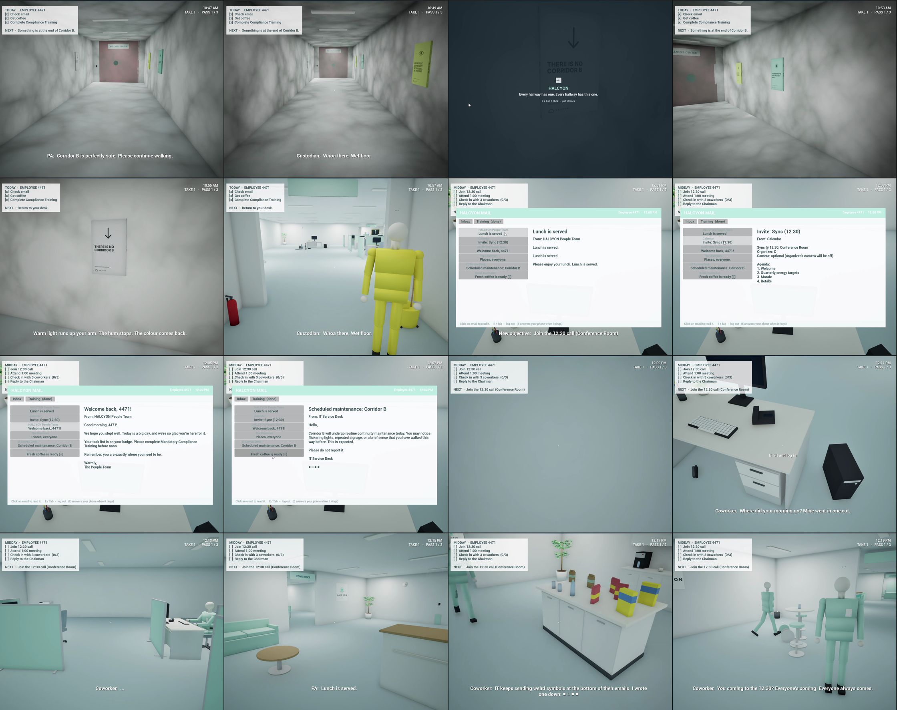
- **My feedback** (1–17), with what was done:
  1. *Items on my desk disappear* 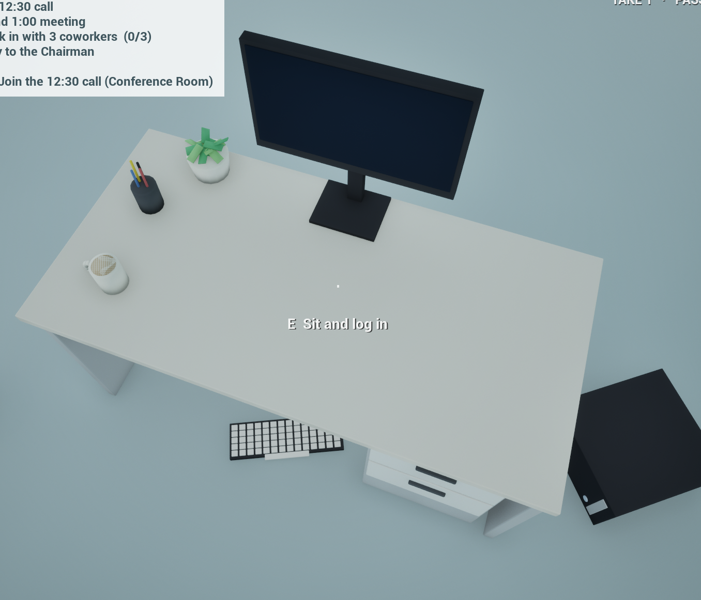: sitting down teleports you next to the monitor, which blasted the physics props off the desk. Your keyboard, phone, pen cup, lamp, plant and stapler are now fixed in place; the mug stays pick-up-able.
  2. *Animate the screens like real computers:* new screen images (inbox, spreadsheet, code, morale dashboard, video call, screensaver, login, plus LOOK CLOSER and a glyph field for Fear). Every monitor flips between them every few seconds. Yours shows a login screen, and your inbox while you're logged in. The monitor mesh got proper screen UVs and an emissive screen material.
  3. Other NPC desks stay physical (unchanged).
  4. *During Fear the desk can go, but it should regenerate:* at Fear 0.75 everything on your desk lifts and scatters. Once Fear drops below 0.25 it puts itself back, but only when you're not looking.
  5. *The clock and the 10:00 meeting don't agree:* Act 1's clock now keeps time with the story: it holds at 9:55 until your morning tasks are done, reads 10:00 for the meeting, then the corridor eats the morning (time runs 3× faster) up to 11:59, so "It was eleven a second ago" is true at lunch.
  6. *Coffee sip looks like it moves away:* the mug now comes to your mouth and tips toward you. Small things are held closer and a little lower, like in a hand.
  7. *Different info for different posters:* each poster (Energy, Present, Corridor B, Smile, Mark, Wellness, and each one's changed version) has its own title and caption.
  8. *Couldn't find glyphs in posters:* the Energy poster carries the Key 2 signature and the Smile poster the Key 3 signature: *Look closer* shows the glyph row under the picture. New posters on the walls: Smile ×2 (office, conference room), Mark, Wellness, Energy (lobby), Present (kitchen).
  9. *Recovering soul energy, Fear vanishing: amazing, I love that transition.* ❤️
  10. *For Fear, all coworkers rise and stare in place:* at Fear 0.75 everyone stops, stands up where they are (seated ones too) and turns to stare at you. No more creeping.
  11. *More fear: they disappear:* at 0.9, anyone you look away from is gone. They're back in their places, working, when it passes.
  12. *TakeBeat works great.* / *No payroll email:* it was waiting on the 12:30 call (not built yet). It now arrives after your first lunchtime check-in.
  13. *Don't answer the phone until email is closed:* E at the terminal only logs out now. The phone keeps ringing while you're seated and you answer it once you stand up.
  14. *Eat snacks:* pick up a snack, drink or fruit, **F: Eat** (crunch) or drink (gulp), with a line, and it's gone from the kitchen.
  15. *Nothing happened in the conference room:* skipping with `TakeBeat 4` jumps past the 10:00 slip. The 12:30 call there isn't built yet (next).
  16. *Plain blocks in the office* 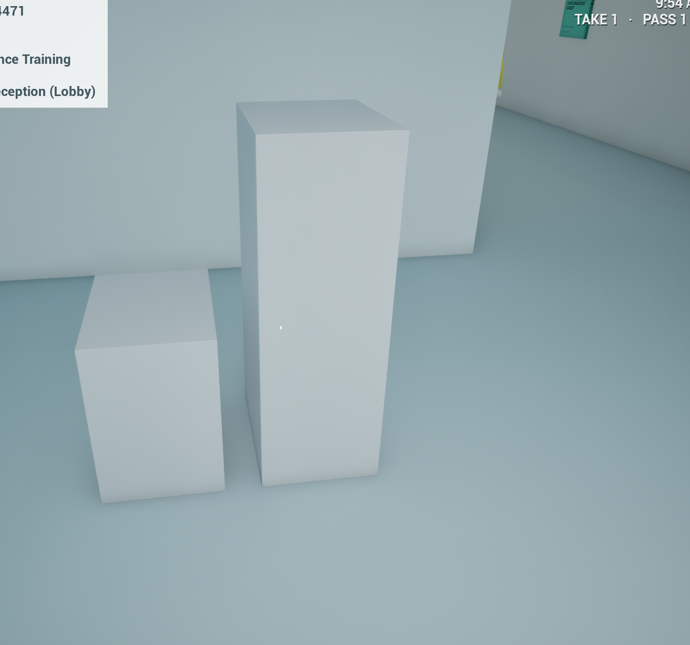: need to find out which ones these are (the level's leftover grey-box props are listed). The supply-closet shelf block is now replaced.
  17. *More items in the supply closet and conference room:* supply closet: three stocked steel shelves (binders, paper, tape, staplers, cups, coffee, tea, snack boxes), a filing cabinet, a printer, a bin, a wet-floor sign. Conference room: an empty director's chair at the head of the table, laptops, mugs, water, a conference phone, paper, a binder, a filing cabinet, a bin, a poster. The call screen shows the video-call image and the Key Lock 2 panel a login screen.
- **New sound:** `sfx_eat_crunch`.
- **AI tools used:** Claude (video and screenshot review, C++, Blender UVs, HTML screen images rendered with headless Chrome, sound synthesis, level dressing).

### Session 46: Sat Nov 14, 2026, 11:00 MST: Compile fix, the "blocks", and 4470

- **Build failed** on one name clash: a loop variable `N` inside a function that already had an `N` (MSVC C4456, treated as an error). Renamed to `MatName`; no other errors in the log.
- **The "random cubes" by Corridor B**  are the two filing cabinets (4-drawer and 2-drawer), placed **backwards**: their drawers faced the wall, so you only saw plain backs. Turned around.
- **My idea:** reference the employee badge number before mine, as if I'm taking their place. Maybe moving-out boxes or their stuff in the supply closet? Claude's take: **4470**, and since your number is also your take number, 4470 is the previous *take* of you. Clues, all subtle:
  - **The janitor closet** (opens with pass 1 from training, so it's a reward): a new **moving box** (cardboard, flaps open, a mug, a frame and papers inside), label *"4470 · PERSONAL EFFECTS · DO NOT OPEN, RETAKE"*; a **polaroid** on top, *"desk 4471, day 1"*, of someone in a mint suit at your desk with the face scribbled out; and a **sticky note** on the shelf: *"if you're reading this it's not your first day. LOOK CLOSER. — 4470"*. Look closer: *"The handwriting looks a lot like yours."*
  - **Your nameplate** on desk #4471: the 4471 sticker doesn't quite cover the 0 of the 4470 underneath.
  - **Email** (Act 1, HALCYON IT): *"Mail addressed to 4470 will now be delivered to you… 4470 is no longer with the production."*
  - **Slips of the tongue:** a coworker: *"Morning, 4470— sorry. 4471. Force of habit."*; the receptionist: *"Welcome back. Oh— first day. Of course. First day."*; the custodian: *"Boxed up the last one's things. Didn't take long. They never have much."*
  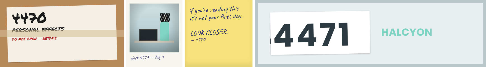
- **AI tools used:** Claude (compile-log fix, Blender moving box, HTML textures with Permanent Marker / Caveat / Poppins via headless Chrome, writing).
- **11:05, my feedback:** omg yes, I love all these details! Especially "Welcome back. Oh— first day. Of course. First day."; the repeated phrases are so clever. The aesthetic is very corporate-artwork and it's coming together. I couldn't see a person in the polaroid. Also two "Ensure condition failed" messages after `import_jam_assets.py`.
- **Polaroid redrawn:** now clearly a person in a mint suit sitting at desk #4471, hand on the keyboard, office chair, window light; the face is still scribbled out until the pen went through.
- **The two "Ensure condition failed" messages** (a matrix that couldn't be inverted, then precision loss in the view transform) came from the renderer the frame *after* the import finished. The log shows the import itself completed: 153/153 files, 35 materials, 6 animations. Most likely one viewport frame drew while the re-imported mannequins and their physics assets were being swapped in. It's an engine warning, not a crash; it happens once and doesn't come back. If it ever repeats every frame, that's different and worth chasing.

### Session 47: Sat Nov 14, 2026, 11:15 MST: Throwing things at people, drawers, 4470's file

- **My feedback:** the screen animations add a lot, and the 4470 references are really cool. Next: (1) hitting a coworker with something outside Fear should get a reaction: a remark about not having had coffee yet, and some could be mean, e.g. the security guard sends a mean email; (2) hitting them in Fear: they turn with an evil face (faces later); (3) the sip goes off to the left now; (4) open filing cabinets; (5) press E on the 4470 things in the closet for more info; (6) whatever else.
- **Done:**
  1. **Hit someone:** they turn to see who did it and say something (16 new lines by role: *"Was that a stapler? Is that how we're doing this today?"*, the custodian *"Throw it at the walls, not at me. The walls can take it."*). Hit the **guard** and Security emails you **"INCIDENT REPORT #4471-B"** (*"This has been noted. It has been noted before. Security does not forget."*); hit three people and the People Team sends *"A gentle reminder about workplace conduct :)"* (*"Please complete Respectful Workplace Module 2… (There is no Module 2. Please stop.)"*). A subtitle tells you your computer chimed. Seated coworkers can be hit too now.
  2. **In Fear:** no words; they snap round to face you and Fear ticks up a little. The evil face plugs in here later.
  3. **Sip drifting left:** the mug was being pushed sideways by your own body as it came to your mouth. Held things no longer collide with you, and the mug stops a little further out.
  4. **Filing cabinets open:** each drawer is its own part and **slides out** (E: "Open the drawer"), with hanging folders inside. Every cabinet on the map (office, conference room, supply closet).
  5. **4470:** the moving box itself is now *Look closer* (it shows its label), not just the small label. And **the top drawer of the office cabinet by Corridor B holds 4470's personnel file**: Status **WRAPPED**, *"Performance: Consistent. Did everything the same way, every time. Notes: Asked about Corridor B. Asked about the clocks. Asked to see the Chairman. Replacement: 4471 (scheduled)"*, with *"they looked closer."* written underneath. 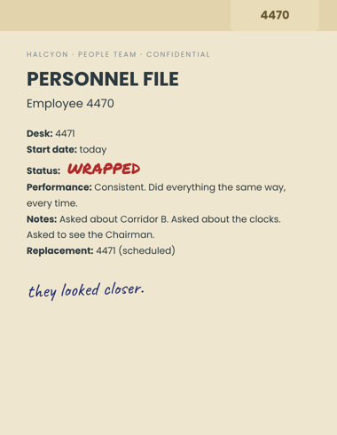
- **AI tools used:** Claude (C++, Blender cabinet shell + drawer, file texture, emails and lines).

### Session 48: Sat Nov 14, 2026, 12:00 MST: The 12:30 call, mail replies, HR, and fun

- **My feedback (11:55):** this is so cool, lots to get through. (1) The coffee maker and vending machine should do more; (2) the clock and the conference call still don't work: 1:02 PM and the call never joined ; (3) join the call in the conference room (laptop or E on the screen); (4) if I miss my desk phone or press the wrong thing, it never rings again; (5) the phone should remind me about the call; (6) the "Employee 4471" screen in the supply closet should do something; (7) a stalker sequence fired (felt random): it slid sideways at me, expand later; (9) save glyphs; (10) reply to emails; (11) HR training if I hit coworkers too much (what should it be?); (12) a fun activity; (13) food and coffee should never run out; (14) unread mail in bold like Outlook; (15) wellness check emails. Also a mannequin with its head off to the side .
- **Done:**
  - **Clock:** the afternoon now follows the story like the morning does. It holds at 12:29 until you join the call, 12:59 until the 1:00 meeting, then 2:13 until the rest of the list is done, then 2:14 and the freeze.
  - **The 12:30 call:** E on the big screen, or on a conference laptop ("Join the call"). Eleven smiling tiles, one frozen mid-laugh, C with the camera off, and live captions that aren't words: they're **Key 2's signature** in squares (auto-noted).
  - **The 1:00 meeting:** the same call, **word for word**. You notice, then *"Item four. Retake. Employee 4471. From the top, please."* The lights flicker.
  - **Phone:** a missed call rings back in 30–45 s. At 12:20 the calendar calls to remind you about the sync, and at 12:55 about the 1:00. If you're far away, you get *"(Back at your desk, your phone is ringing.)"*
  - **Mail:** unread mail is **bold** with a dot, and the Inbox tab shows the unread count. You no longer auto-open the first email. **Every email has replies:**
    - Replying to the Chairman's notes ticks the Act 2 task.
    - Sending your key to "Payro11" is a bad idea; reporting it is good. Each choice gets its own follow-up email.
    - "Decline" on the invite accepts anyway.
    - Writing to 4470 bounces.
  - New-mail chime with an unread count.
  - **Wellness check** (12:00): Great / Fine / **Something is wrong** (→ Fear, a booking at the Wellness Center, a follow-up).
  - **Glyph notes:** every signature you find (poster, call captions) is saved. See Pause → Tasks; saved in save files.
  - **Key Lock 2:** the "Employee 4471" login screen in the supply closet is now a terminal. Its signature is **hidden** ("you should know it by now"), so you match it from your notes. Solving it gives **Pass 2**, and the screen says *"Welcome back, 4470."* plus a sign-in email.
  - **HR:** every 3 hits assigns a **Respectful Workplace** module in the Training tab:
    - **Module 2:** *"Words are free. Staplers are company property."* A quiz where throwing a mug is "Correct! (Recorded.)", ending on a full-screen **"Please stop."**
    - **Module 3** (6 hits): *"Will you stop?"* Yes / Yes.
    - A certificate email when you finish.
  - **Coffee machine:** E with a mug in hand refills it. Without one, a fresh full mug slides out with your name on it (never runs out). In Fear it pours black. Five cups = an email from Wellness: *"Please don't stop."*
  - **Vending machine:** E drops a snack. It's always B4. One line mentions a badge stuck behind the glass: 4470.
  - **Food comes back** to its spot 40–70 s after you eat it, when you aren't looking.
  - **Fun activity: paper toss.**
    - Crumpled paper balls sit by your bin and on some desks (new SM_PaperBall).
    - Anything you throw that lands in a bin scores, and the game tracks your streak.
    - Three in a row earns an email from Morale.
  - **Head offset fixed** in the rig (twists were on the wrong axis); re-exported.
  - **Rebuild.bat** in the project folder: builds the C++ and opens the editor, or shows the errors and stops.
- **AI tools used:** Claude (C++, emails and lines, Blender paper ball and rig fix, batch script).

### Session 49: Sat Nov 14, 2026, 12:40 MST: Build OK, and a music partner

- **Rebuild.bat works:** the session 48 batch compiled on the first try (21 files, ~70 s). The first two attempts failed only because the editor / Live Coding was still running.
- **Music:** I'm composing in Ableton, with **Sol (ChatGPT)** as my creative assistant: extending and looping what I compose, plus creative tasks. Sol works in a separate private repo (`PhoenixLynx/epicjam-creative-assets`, folder `Music_Video_Assets`) and never writes to the game folder.
- **How Claude and Sol talk:** a `handoff/` folder in Sol's repo. Claude writes `FROM_CLAUDE.md` (where music goes in the game, spec, priorities) and the shared `ASSET_REQUESTS.md` table (10 cues: morning loop + Fear layer, the HALCYON jingle, hold music, the lunch variation, stingers for "Retake" and the 2:14 freeze, title, chase, wrap party). Sol answers in `FROM_SOL.md`. I approve everything; audio freeze Sunday 12:00 PM.
- **Caught by Sol:** the gameplay video (30-60 s, 1080p) is *required* by the rules, not optional. Checklist fixed.
- **AI tools used:** Claude (build log check, handoff brief), Sol / ChatGPT (creative workspace, provenance records, rules review).

### Session 50: Sat Nov 14, 2026, 13:10 MST: Playtest fixes, and lunch is actually served

- **My notes (13:07):** (1) the custodian in the supply closet talks to you through the closed door; (2) the clock still ran all the way to 11:59 in the morning; (3) I collected the energy sphere at the end of the corridor but didn't know how to get pass 3; (4) saving glyphs is really helpful; (5) I could join the call (more feedback later); (6) "Lunch is served", so there should be different food; (7) in Fear the coworkers stood still at first, then seemed to move around again; (8) loving the details. Recording: `screenshots/Recording 2026-11-14 125325_fearcoordidor.mp4`; the phone reminder working: 
- **Fixes:**
  1. Talking (E) and bump lines now need a clear line of sight: no conversations through closed doors.
  2. The corridor part of the morning stops at **10:59** and runs at the normal pace, so the jump to 12:00 ("It was eleven a second ago") makes sense.
  3. Pass 3 isn't in the game yet: it's Key 3, hidden in the Smile poster (already in your notes), and it unlocks in Act 3 tonight.
  6. **Lunch:** a catering table and lunch on the cafe tables appear at 12:00. New: sandwich, pizza slice, salad, donut, each with its own line when you eat it (*"Every leaf is the same size. Every leaf."*). The director's chair by your desk (tagged for Act 2 since Thursday but never revealed) now shows up at lunch too.
  7. **Fear:** once coworkers start staring, Fear has to drop clearly and stay down for 2.5 s before they go back to work. Fear hovering around the threshold was flipping them between staring and walking.
- **AI tools used:** Claude (recording review via contact sheet, C++, Blender lunch props).

### Session 51: Sat Nov 14, 2026, 13:25 MST: Signs, a restroom, and machine easter eggs

- **My asks:** (1) caution logos on the wet floor signs and other signs; (2) add a restroom; (3) more easter eggs for the coffee and vending machines. Sol is generating the coworker faces.
- **Signs:** wet floor signs now print **CAUTION / slipping figure / WET FLOOR / (always)** on both faces; exit signs say **EXIT** with a running figure. Both are original HTML/SVG drawings. A per-slot material system in `dress_campus.py` (`SLOT_MI`, plus `SlotMI=` tags) lets any prop carry a printed face. 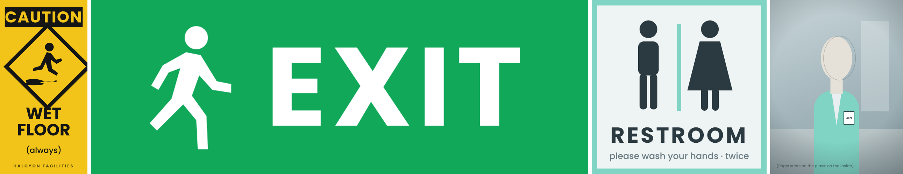
- **Restroom** (north-east corner of the open office, door in its west wall, sign by the door: *"RESTROOM · please wash your hands · twice"*):
  - **Sink:** *"exactly the right temperature"*. **Hand dryer:** it *"starts before your hands are under it"*. **Toilet:** flushes; the third time, the PA quietly says *"Thank you."*
  - **The stall is always occupied:** E = knock. *"Occupied." → "Still occupied." → "...Occupied, 4471."* In Fear: *"Occupied. Occupied. Occupied."*, very close to the door. **And only in Fear, there are shoes under the stall door.**
  - **The mirror** (look closer): you in a mint suit, a reflection that blinks late, fingerprints *on the inside* of the glass.
  - The printer moved out of that corner.
- **Coffee machine eggs:**
  - cup 10: *"YOU HAVE EXCEEDED TODAY'S JOY ALLOWANCE. ...JOY GRANTED ANYWAY."*
  - cup 15: *"HELLO 4470. ...SORRY. HELLO 4471. THE USUAL?"*
  - after 2:14 the coffee stops in mid-air
  - hold anything that isn't a mug under it and it fills it anyway
- **Vending machine eggs:** the keypad only has 4, 7 and 1; *"YOUR USUAL"*; in Fear it's empty but something drops anyway; after 2:14 *"OUT OF TIME… Best before 2:14."*
- **New:** 7 meshes (toilet, sink, mirror, hand dryer, stall door, shoes, sign plaque), 4 textures, 4 sounds (tap, dryer, flush, knock).
- **AI tools used:** Claude (Blender props, HTML/SVG sign art via headless Chrome, numpy sound synthesis, C++, level dressing).

### Session 52: Sat Nov 14, 2026, 13:50 MST: Faces

- **Sol (ChatGPT image generation, directed and approved by me)** made the coworker face pair, ART-001: a calm HALCYON face with star catchlights, and a Fear face with dark under-eye circles, lowered brows and a too-wide smile. I approved v02 and asked for 1.5x thicker lines so they read from a distance. v03 final exports are 1024x1024 with a transparent background; provenance is in Sol's repo.
- **In the game:** every rigged mannequin now has a thin curved **face card** on the front of its head (part of the skeletal mesh, skinned to the head bone, so it turns and stares with them). It shows the **calm face** normally and switches to the **Fear face** while they stare at you, for 4 s after you hit one during Fear, and briefly if you hit one while things are already uneasy. A masked material (`M_FaceTexture`) uses the texture's alpha, with a low cutoff so the soft under-eye circles survive.
  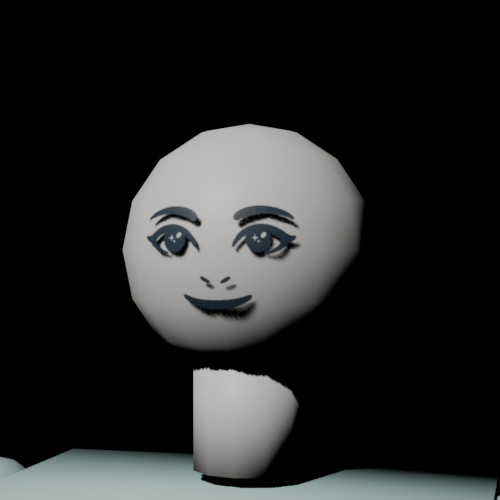
- **AI tools used:** Sol / ChatGPT (face images), Claude (rig face card, material, C++ face swap, Blender preview render).

### Session 53: Sat Nov 14, 2026, 14:20 MST: First-frame black, a tidy morning, faces fixed

- **My notes:** (1) at the start, the desk shows through before the opening; the start screen should come first; (2) strange items on the floor by my desk are distracting at first; save trash-like things for after lunch; (3) the face textures don't show on the people.
- **Fixes:**
  1. The cold open is black from the very first frame: the camera itself fades (not just the HUD), and a long first frame while the map loads can no longer skip the black.
  2. The crumpled paper by your desk only appears after lunch (Act2Reveal), so the morning starts clean.
  3. Faces: the log said *"Material with missing usage flag was applied to skeletal mesh"*. The face material wasn't marked for use on rigged meshes, so Unreal silently drew the default instead. `M_FaceTexture` now sets **Used with Skeletal Mesh**.
- **AI tools used:** Claude (log diagnosis, C++, scripts).

### Session 54: Sat Nov 14, 2026, 14:55 MST: Lunch island, lobby, elevator, cameras, energy, playtest tools

- **My list (14:30):** faces work now . Notes:
  1. Lunch is on a small table and falls off; it should go on the main island with a lunch sign and daily specials 
  2. Security cameras, maybe a security desk
  3. Make the lobby more "inviting"
  4. The elevator is too blank : buttons inside, emergency signs
  5. A sign-in clipboard at the front desk
  6. Sol is making neutral faces (security, janitor) and a frown for when you hit someone
  7. New screenshots
  8. Sol is making a title background placeholder
  9. A training movie (nice to have)
  10. A way to skip puzzles for playtests, and a way to take notes in game
  11. An energy bar
  12. The email task should need inbox zero
- **Done:**
  - **Lunch** sits on the kitchen island under a **LUNCH IS SERVED · TODAY'S SPECIALS** board (*"Turkey sandwich (you asked for turkey)"*, *"Soup of the day: yesterday's"*). The catering table is gone, and the snacks moved to the cafe tables.
  - **Reception:** a visitor sign-in clipboard: *4471, 9:00* on every line, one *4470: wrapped*, and an empty line *"sign here →"*. A sign: *"Please wait to be called. You will be called."*
  - **Lobby:**
    - a rug with the HALCYON sun
    - two armchairs, a plant and a water cooler
    - a **HALCYON QUARTERLY** magazine (*Employee of the Take: 4471. Issue date: tomorrow.*)
    - a promo screen (*"Your energy. Our future. Now hiring: 4472."*)
  - **Security desk** by the elevator: two monitors with four CCTV feeds. Feed 4 is **DESK 4471: YOU (FROM BEHIND)**. **Seven security cameras** around the campus slowly turn to follow you.
  - **Elevator:**
    - a button panel inside (E): *"You press 2. The light comes on, then goes out. 2 hasn't happened yet."* / *"FLOOR 3 IS IN POST-PRODUCTION"* / *"C: AUTHORISED PERSONNEL ONLY. ...YET."* / *"B4 IS NOT A FLOOR"*
    - signs: *"IN CASE OF FIRE, DO NOT USE THE ELEVATOR. IN CASE OF RETAKE, REMAIN WHERE YOU ARE."* and *"EMERGENCY: There is no emergency. Remain calm. Remain."*
  - **Energy:** ten cells under the clock. It drains over about 15 minutes. A coffee sip gives +10, food +20, a drink +12, and the wisp fills it. Under 25% you walk 20% slower and get a nudge toward coffee. It's never a fail state.
  - **Email task = inbox zero** (*"Inbox zero. HALCYON is proud of you."*).
  - **Playtest tools:**
    - **F8** (or Pause → Playtest notes → *Skip current tasks*) finishes the current task list: morning → lunch → 2:14.
    - **Pause → Playtest notes** saves typed notes to `Saved/PlaytestNotes.txt`, stamped with the real time, game clock, act, take and position.
  - **Faces:** the code looks for `MI_Face_Neutral` (guards, custodian) and `MI_Face_Frown` (4 s after a hit outside Fear) and uses them as soon as Sol's exports are in. Asked in the handoff.
  - Later: the title screen with Sol's placeholder background (with Act 3), the training movie (nice to have).
- **New:** SM_SecurityCam; 10 textures (lunch board, sign-in sheet, CCTV, promo, magazine, rug, elevator panel, 3 signs). 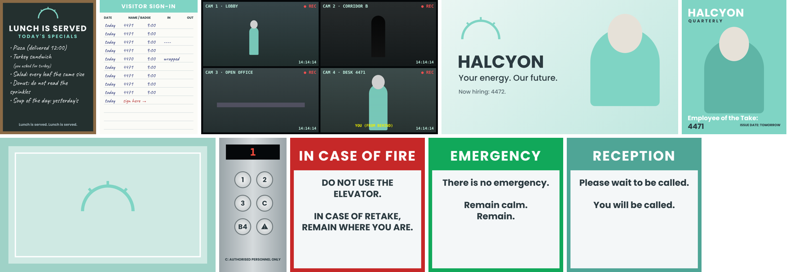
- **AI tools used:** Claude (HTML/SVG textures via headless Chrome, Blender camera, C++, level dressing). Sol / ChatGPT (faces, title background in progress).

### Session 55: Sat Nov 14, 2026, 15:05 MST: First in-game playtest notes

- **The in-game notes work:** 17 notes, typed while playing (N), each with real time, game clock, act and position, in `Saved/PlaytestNotes.txt`. Claude read them straight from my PC. F8 skip works great.
- Several notes were things already fixed but **not yet imported/dressed** (objects by the desk, blank elevator, lunch on the small table, neutral faces). Running `import_jam_assets.py` + `dress_campus.py` brings them in.
- **New from the notes:**
  - **Intro bleed:** the HUD's black now starts *visible*, before any story code runs.
  - **F9 = screenshot** to `Saved/Screenshots`.
  - **Energy drains** from phone calls (-5), meetings (-10) and Fear (3x faster); the water cooler gives +5.
  - **E to talk only when there's a "!"**: the "!" is the to-do marker, so it tells you who still has something for you.
  - **Janitor closet:** the custodian now waits outside by the door, and the clutter moved to the walls, so you can walk in and find 4470's things.
  - The lobby poster that covered the kitchen doorway moved.
  - **Coworkers nudge you toward what's next** (30% of their small talk), e.g. *"Twelve thirty, conference room. The Chairman's calling in. Camera off, as usual."*
  - **Fear:** coworkers now react at Fear 0.6 (was 0.75), so seated ones stop working and stare sooner. A new **Fear stinger** (reversed swell into a low boom and a shatter) plays the moment the office turns.
  - **Lobby:** throwable brochures (*"Welcome to HALCYON: a guide for new employees (and returning ones)"*) and magazines, another plant.
  - **Reception:** a monitor with the CCTV feeds, and the receptionist's **script notes** on the desk (*"INT. HALCYON LOBBY - MORNING... Welcome back. (beat) Oh -- first day."*, with *"smile with the eyes. AGAIN. - C"* in red pen).
  - **Lunch attendant** (Act 2 only): a white-coated mannequin with a **chef's hat** behind the island (*"Today's special is the special."*, *"Careful. The hat is load-bearing."*).
  - **Kitchen:** a bulletin board (lost red stapler, fire drill *"Date: you'll know"*, cake for 4471's birthday *"(again)"*, *"Morale is mandatory. Fun has been scheduled for 2:14."*) and two morale posters.
  - **Water coolers:** E pours a cup; someone by the cooler gossips (*"...did you hear about 4470? No? ...Nobody did."*).
  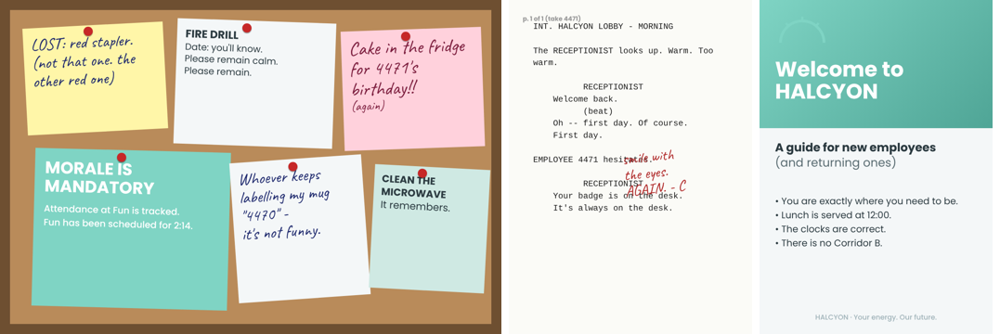
- **AI tools used:** Claude (reading my playtest notes, C++, Blender chef variant + brochure, HTML textures, sound synthesis).

### Session 56: Sat Nov 14, 2026, 15:25 MST: Playtest round 2

- **Notes (read from `PlaytestNotes.txt`):** intro no longer bleeds through; the custodian can go back in the closet as long as he's only reachable with the door open; add a resume button to the notes page; the guard says the supply closet is restricted but I can walk right in (and the login is in there); the printer/copier should print things; *"nice, it makes a mad face now"*; brochures work; the reception sign floats off the desk. F9 screenshots work (`Saved/Screenshots/WindowsEditor/`).
- **Fixes:**
  - The custodian is back inside the closet, by the door; the line-of-sight check means you only reach him with the door open.
  - **Save note & resume** button on the notes page.
  - **The supply closet now has a door that needs access pass 1**, matching what the guard says. The Key Lock 2 login is behind it, so the order holds: training → pass 1 → supply closet → Key Lock 2 → pass 2.
  - **Printers print** (E): a page drops out that you can pick up and throw. It cycles through three printouts: a continuity memo, *"PRINT JOB 4470 (queued)... blank except for a row of squares"*, and *"YOUR PERFORMANCE: 99%. Please give the remaining 1%."* New `sfx_printer`.
  - The reception sign now stands on the desk.
  - Prompts for the new things: Print / Get some water / Press a button.
- **AI tools used:** Claude (notes and screenshot review, C++, textures, sound).

### Session 57: Sat Nov 14, 2026, 15:35 MST: Scene cards between times of day

- **My ask:** I like the TAKE transitions; use them between times of day too.
- **Done:** the opening slate now reads **TAKE 1 / 9:00 AM · SCENE 1 · MORNING**. The jump to lunch is a quick scene card: black, clapper, **12:00 PM / SCENE 2 · LUNCH**, back in about 2.5 s, then *"...Twelve? It was eleven a second ago."* When the clocks stop: **2:14 PM / SCENE 3 · HOLD**. Act 3 gets its own card. Same look as the TAKE slate (one `ShowTimeCard` call).
- Also: Sol's title background **v11** (lobby, director's chair on the X, no baked HUD) is in the project for the title screen, with v10 as an alternate. Sol is redoing the faces in the aesthetic we named **"uncanny minimalism"**.
- **AI tools used:** Claude (C++). Sol / ChatGPT (title art).

### Session 58: Sat Nov 14, 2026, 16:05 MST: Playtest round 3 (last before Act 3)

- **Notes highlights:** intro and scene 2 transitions work; *"the transition out of fear mode is satisfying"*; joining the meeting syncs with the clock; *"love the chef!"*; the mad face works.
- **Fixes:**
  - **New faces in the "uncanny minimalism" style** (Sol: calm, Fear, neutral, frown) replace the earlier ones (same slots, no code change).
  - **Wet floor sign** was built as a V (feet together, tops apart); now a proper A-frame.
  - Restroom: an inexplicable chair in the empty corner.
  - The plant blocking the office entrance is gone; brochures sit on the coffee table (they were placed past its edge).
  - **Security booth** moved to the lobby's north-west corner with a low counter, so the Chairman's portrait is visible again. (A real entrance with windows to the outside: Sunday polish list.)
  - **Elevator car:** brushed-steel walls, floor plate and handrail (a metallic material, so Lumen gives it soft reflections), keeping it open as part of the entrance.
  - **Conference room:** the stray filing cabinet became a **whiteboard** (*"Q4 energy targets ↑↑↑ ... who keeps drawing squares on this?"*). Looking closer shows **Key 2's squares** and adds them to your notes.
  - **Hit counts:** the receptionist asks you to sign an incident report and counts incidents; the Security and HR emails now include the count.
  - **Take someone's monitor/keyboard/laptop/mug:** the nearest coworker turns, frowns and gets snarky (*"I had seventeen tabs open on that."*).
  - **Fear:** coworkers now stop and stare from Fear 0.35 (the corridor scare level), and vanish when unseen from 0.85. The Fear stinger plays at 0.35. Fear face while staring.
  - **Check-ins explained:** the task now reads *"Check in: Reception, Security, Custodian (n/3)"*. It's the three story characters with a "!" (Lunch conversation), not the office extras.
  - **Lunch** items get a fresh physics body when revealed, so you can pick them up.
  - **F7** = the stalker, now (playtest), alongside F8 skip.
- **Answered:** "why fear again at 12:19?": Fear rises from certain email replies (sending your key to "Payro11", *"What camera?"* to the Chairman, *"Something is wrong"* to Wellness) and from throwing things during Fear. To be checked in my notes.
- **AI tools used:** Claude (C++, Blender, HTML whiteboard, level dressing). Sol / ChatGPT (uncanny minimalism faces).

### Session 59: Sat Nov 14, 2026, 17:10 MST: Act 3, the ending, and the title screen

- **Starting Act 3.** One last note first: the security booth chair clipped through the counter and the booth needed a seated guard. Fixed: the counter moved in front of the chair and a guard now sits at the booth watching the feeds.
- **I got the Max plan** 🎉
- **Title screen (new):** the game launches to Sol's lobby key art (v11) with **TAKE 4471 · START / CONTINUE / QUIT**. CONTINUE appears when there's a save. The office waits paused behind it; START plays the cold open.
- **Act 3: Overtime** (compact version of the storyboard):
  1. **SCENE 4 · OVERTIME** (2:14 PM, still): 20 s after the clocks stop with the Act 2 list done, the PA announces mandatory team building in the Wellness Center. Objective: get **access pass 2** (the supply-closet terminal) if you haven't, then go to the Wellness Center. Its doors now open with pass 2.
  2. **Team building:** six coworkers stand in a circle around a mint X. E on the X: *"Fall back, 4471. We'll catch you."* The view tips back...
  3. **SCENE 5 · THE WARD:** *"...Nobody caught you."* You're in the hospital below: beds in rows like cubicles, cold lights, a red REC light. Fear stays at or above 0.55. **The stalker** comes after about 25 s; throw things to stun it. If it catches you: **CUT. AGAIN.** at the ward door (not your desk), and it returns 15 s later.
  4. **The charts are script pages.** *PATIENT 4471* and *BED 7* (*"They will hesitate here." You hesitate.*) carry **Key 3's squares**. *PATIENT 4470* has squares *"added later, in a different hand"*: a **decoy**. All three go into your notes, so you can see two agree and one doesn't. (The Smile poster from Act 1 also has Key 3.)
  5. **The nurses' station terminal** (Key Lock 3, signature hidden) → **access pass 3**.
  6. **The service elevator** (pass 3) → **SCENE 6 · C**: you're back in the elevator upstairs. C is lit.
- **The ending: WRAP PARTY.** Press C → *??:?? · WRAP PARTY*. Everyone in the lobby in a half ring, smiling at you, applause, paper confetti (paper balls and brochures). *"That's a wrap on Employee 4471!"*, *"(The clock over the elevator still reads 2:14.)"*, then **the Collector**: *"...You just have to hand over your keys."*
  - **YES** → *"A bright palace... everyone smiling a beat too long."* → **THE THEATRICAL CUT**
  - **NO** → your passes are gone; three seconds of the uncut office (empty desks, badges on hooks) → **THE DIRECTOR'S CUT**
  - Then *SOUL SIGHT / THE COLLECTOR IS ██████*, cut to black, **credits** (cast: *Employee 4470: also you*; the Chairman: *(camera off)*; **Directed by ________**) → back to the title. START begins a new take.
- **The stalker** now uses the rigged mannequin (dark, 1.3x tall, Fear face) with the walk animation, faces where it walks (no more sliding sideways), and walks straight at you where there's no navigation mesh (the ward).
- **Playtest:** F8 steps through Act 3 (pass 2 → fall → pass 3 → elevator → ending); `TakeBeat 5` jumps to Act 3.
- **New:** SK_MannequinStalker; textures for 4 charts, the X, the service sign; `sfx_applause`; ward lights.
- **AI tools used:** Claude (C++ Act 3, ending, title and credits widgets, Blender stalker variant, HTML textures, applause synthesis, level dressing). Sol / ChatGPT (title art).
