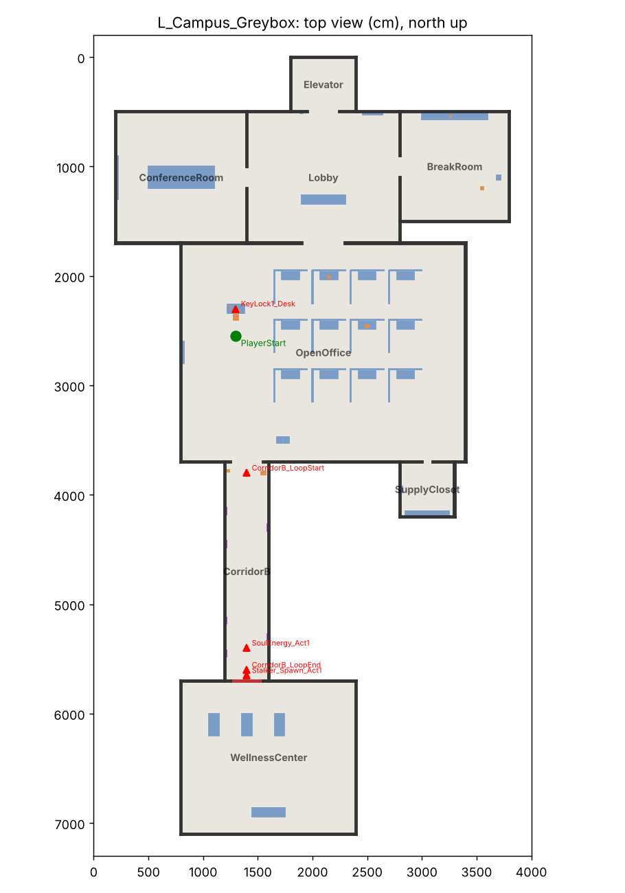
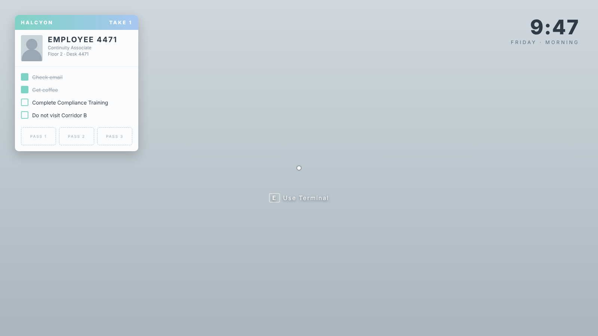
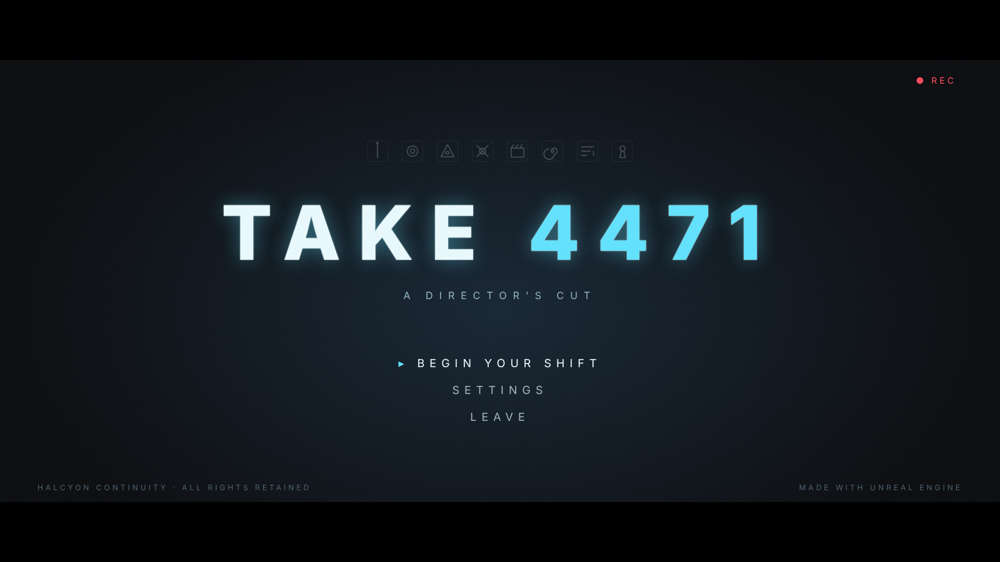
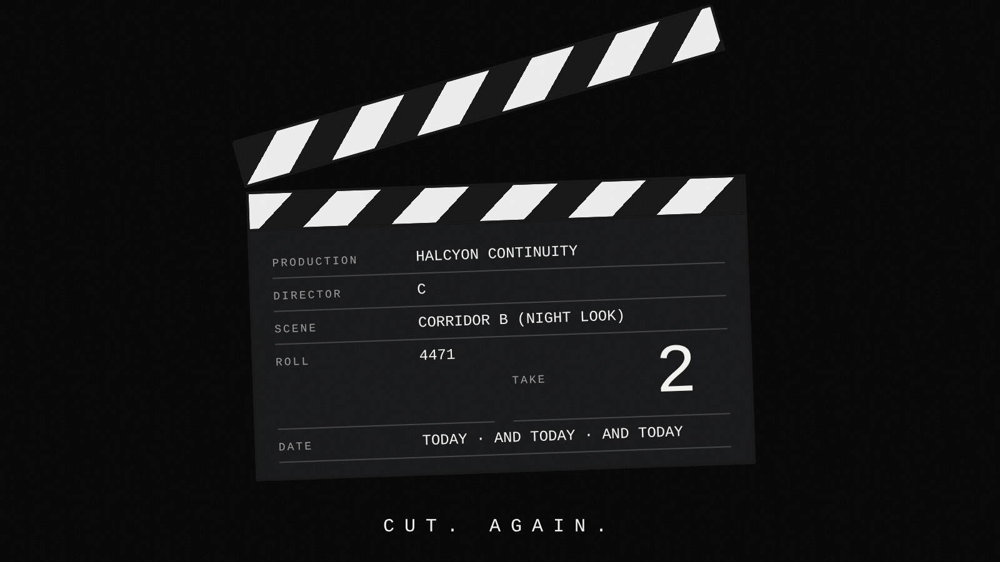
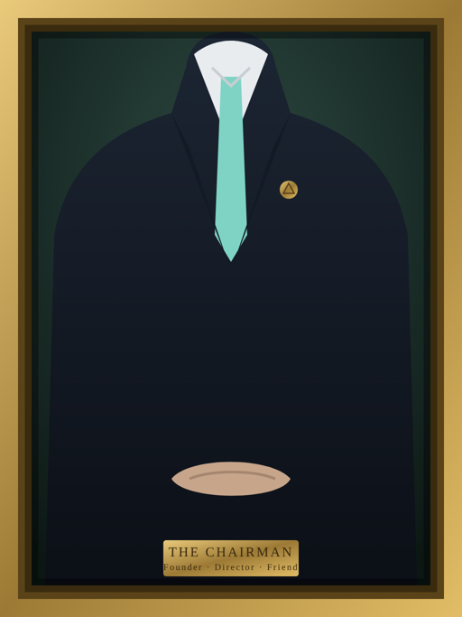

# Devlog: 2026 Epic AI MegaJam (itch.io)

**Developer:** phoenixlynx (solo)
**Engine:** Unreal Engine
**Jam dates:** Thu Nov 12 – Sun Nov 15, 2026
**Deadline:** Sun Nov 15, 2026, 6:59 PM Phoenix time (MST, UTC-7)
**Theme:** DIRECTOR'S CUT
**Log started:** Thu Nov 12, 2026

Every asset and line of gameplay code in this project is made during the jam window.

---

## Stage tracker

| # | Stage | Status | Started | Finished |
|---|-------|--------|---------|----------|
| 1 | Concept | ✅ Done | Nov 12 19:19 | Nov 12 19:54 |
| 2 | Storyboard | ✅ Done | Nov 12 19:59 | Nov 12 20:05 |
| 3 | Prototype | 🔄 In progress | Nov 13 12:50 | |
| 4 | Art | ⬜ | | |
| 5 | Audio | ⬜ | | |
| 6 | Polish | ⬜ | | |
| 7 | Packaging | ⬜ | | |
| 8 | Submission | ⬜ | | |

---

## AI tool ledger

A running record of every AI tool used and what it did.

| When (MST) | Tool | What it did |
|------------|------|-------------|
| 2026-11-12 19:17 | Claude (Anthropic) | Set up repo scaffold: git on `main`, Unreal .gitignore, Git LFS tracking, folder layout, this devlog, submission checklist. |
| 2026-11-12 19:19 | Claude (Anthropic) | Turned my raw concept notes into docs/CONCEPT.md: layer structure, core loop, XOR Key Lock puzzle design, seed approach, MVP scope, Real World options. Ideas and direction are mine; Claude structured and scoped them. |
| 2026-11-12 19:26 | Claude (Anthropic) | Updated CONCEPT.md to v0.2 from my direction: corporate campus start, Soul Sight "slip" progression, Augmented Fear layer + creep stages, Wellness Center → Hospital, Unreal techniques for the transition, revised MVP/stretch list. |
| 2026-11-12 19:27 | Claude (Anthropic) | CONCEPT.md v0.3 from my direction: escalation table, "trapped in time and space" mechanics (loops, frozen time, rewind on capture), subtle Key Lock with a 3-key difficulty ramp. |
| 2026-11-12 19:30 | Claude (Anthropic) | CONCEPT.md v0.4 from my direction: NPCs as seeded malware agents with false clues; party ending with the Collector, broken into beats. |
| 2026-11-12 19:36 | Claude (Anthropic) | CONCEPT.md v0.5 from my direction: improvised combat (objects, fire extinguisher, path-blocking debris) with Unreal implementation notes; ending offer + Yes/No choice. |
| 2026-11-12 19:37 | Claude (Anthropic) | CONCEPT.md v0.6 from my direction: coffee burn + more office weapons; "astral logic" powers tiered by soul bits, with Unreal implementation notes. |
| 2026-11-12 19:40 | Claude (Anthropic) | Web-searched the jam rules on pre-made assets and the theme. Added the music plan (stems composed during the jam + MetaSounds runtime generation) to CONCEPT.md; added rule items to the checklist. |
| 2026-11-12 19:42 | Claude (Anthropic) | Wrote docs/AUDIO_PLAN.md: bright/dark ambient palettes, 7 generative techniques, recording list. I compose all the music; Claude designed the generative system. |
| 2026-11-12 19:46 | Claude (Anthropic) | Brainstormed "Director's Cut" theme tie-ins → docs/THEME_BRAINSTORM.md (core reframe, mechanics, ending, titles). Web-searched to try to confirm the theme officially (not confirmed yet). |
| 2026-11-12 19:48 | Claude (Anthropic) | CONCEPT.md v0.7: folded in the theme. "Orchestrated movie" spine, the Chairman with a 7-step foreshadowing list, movie motifs, wrap-party ending, theatrical vs. director's cut. |
| 2026-11-12 19:52 | Claude (Anthropic) | CONCEPT.md v0.8: workday activity table (email, compliance training, video calls, meetings, NPCs, team building) and day structure (3 acts = 3 keys). |
| 2026-11-12 19:54 | Claude (Anthropic) | Read Epic's partner-perks email I shared; confirmed the theme; sorted perks into use / maybe / skip for this game in docs/RESOURCES.md (codes and links left out of the repo). |
| 2026-11-12 19:59 | Claude (Anthropic) | Drafted storyboard/STORYBOARD.md v0.1 from the concept: campus map, beat tables for Acts 1–3 and the ending, MVP/stretch tags, screenshot markers, scope fallback. Added SourceArt/ folders + LFS/ignore rules for Blender and Ableton files. |
| 2026-11-12 20:06 | Claude (Anthropic) | Added access passes, security guards and custodians to CONCEPT.md and STORYBOARD.md from my direction. |
| 2026-11-13 12:50 | Claude (Anthropic) | While I was at work: wrote the grey-box campus builder (Unreal Python), the XOR Key Lock generator + tests + Blueprint port spec, and the first game text tables (emails, PA lines, compliance training, NPC lines, script pages). |
| 2026-11-13 13:00 | Claude (Anthropic) | Glyph alphabet (8 glyphs × lit/unlit + hidden), UI mockups (Key Lock, inbox, HUD badge), Blueprint recipes, grey-box additions (throwables, loop, Hospital, nav mesh), Fear materials script, 11 synthesized placeholder SFX. |
| 2026-11-13 15:27 | Claude (Anthropic) | Enabled the Python, Editor Scripting, Unreal MCP and All Toolsets plugins in the .uproject (exact names read from my UE 5.8 install); wrote preflight_check.py, init_unreal.py (auto-starts MCP) and docs/TONIGHT.md. |
| 2026-11-13 15:32 | Claude (Anthropic) | Wrote docs/PRODUCTION_CHECKLIST.md: every task to submission with owners, timing, done-criteria and checkpoints. |
| 2026-11-13 15:39 | Claude (Anthropic) | Wrote the rest of the game text (Act 2–3 NPC lines, prop text incl. call sheet, the full ending with both branches, credits); designed the title, TAKE slate and loading screens; generated 6 HALCYON posters (+ loop twins) and the Chairman portrait from code. |

---

## Sessions

### Session 1: Thu Nov 12, 2026, 19:17 MST: Setup

- **Goal:** Get the repo, folders, and record-keeping ready before any game work.
- **Done:**
  - Git repo initialized on branch `main`.
  - Unreal `.gitignore` added (Binaries/, Intermediate/, Saved/, DerivedDataCache/, .vs/, and the usual extras).
  - Git LFS tracking for `.uasset .umap .fbx .blend .wav .png .mp4`.
  - Folders created: `devlog/`, `devlog/screenshots/`, `storyboard/`, `docs/`.
  - `devlog/DEVLOG.md` and `docs/SUBMISSION_CHECKLIST.md` created.
- **Decisions & why:**
  - LFS set up before the first asset, so no binary ever lands in plain git history (that's hard to undo later).
  - The repo root is meant to be the Unreal project root (the folder with the `.uproject`), so the ignore paths match.
- **Problems:** Remote URL and theme not provided yet.
- **AI tools used:** Claude (scaffold + docs).
- **Next:** Get theme and game ideas → Concept stage. Connect remote and push.

### Session 2: Thu Nov 12, 2026, 19:19 MST: Concept

- **Goal:** Get my concept out of my head and into a buildable shape.
- **Done:**
  - Wrote out the raw idea: recover soul energy from gatekeeper entities in an Astral Real-Time Zone, mint soul bits by solving generated keys, upgrade Soul Sight until you can see through the interface to Source. Cryptographic horror.
  - Drafted `docs/CONCEPT.md` (v0.1).
- **Decisions & why:**
  - **Astral Zone = overlay on the same level, toggled by Soul Sight.** Halves level-building work, and "seeing through" is the core fantasy anyway.
  - **XOR Key Lock as the lead puzzle.** It reads as cryptography, is guaranteed solvable when generated backwards from a hidden answer, and ties directly into Soul Sight (hidden bits, decoy false bits).
  - **Unrecreatable runs** via a clock-based seed, plus a dev-only override for debugging.
  - **MVP = 3 soul bits to win**, 1 level, 1 enemy + 2 variants.
- **Real World options (undecided):**
  - **A: Cached Home.** Your own apartment, but rendered like a cache: textures load in late, photos have faces replaced by scrolling hex, rooms repeat with tiny differences, the front door opens to a hallway that ends in a loading spinner. Personal (fits "your soul"), cheap to build.
  - **B: Onboarding Campus.** A bright corporate wellness office. Every door asks for consent, posters thank you for your energy, the staff are mannequins with name badges. Strongest Magilumiere / Death Note "contract" flavor.
  - **C: Terms Street.** A quiet night street where every sign, receipt and billboard is fine print that rewrites itself when you look away.
- **Problems:** Theme still unknown, so the concept may need to bend.
- **AI tools used:** Claude (concept structuring + scoping).
- **Next:** Theme → lock concept → storyboard.

### Session 3: Thu Nov 12, 2026, 19:26 MST: Concept direction locked

- **Goal:** Pick the Real World and define the enemy experience.
- **Done:**
  - **Real World = the Campus:** you start as a standardized citizen-employee at a bright corporation. The cheer is there to contrast with the conspiracy underneath.
  - **Soul Sight is something you slip into**, growing with each solved key: involuntary flickers at first, full sight at 3 soul bits.
  - **XOR Key Lock confirmed** as the puzzle, uniquely generated every time.
  - **New layer: Augmented Fear.** The malware brainwashes and inflicts extreme fear. You slip into it without knowing exactly when, until you're being stalked and chased. It should feel visceral. Not a siren-style hard switch.
  - **Hospital:** the campus Wellness Center becomes the Hospital in Fear.
  - Concept doc updated to v0.2.
- **Decisions & why:**
  - Soul Sight (truth) and Augmented Fear (lies) are framed as opposites; Soul Sight can pierce Fear but drains fast. One tension drives both systems.
  - Fear is one 0→1 value driving post-process, materials, audio and off-screen actor swaps, so the creep is gradual and it's all one system to build.
  - Hospital wing moved to stretch goal #1; Wellness Center covers it in the MVP.
- **Problems:** Theme still unknown.
- **AI tools used:** Claude (concept doc update, scoping, Unreal technique suggestions).
- **Next:** Theme → storyboard (campus layout + first Fear episode beat by beat).

### Session 4: Thu Nov 12, 2026, 19:27 MST: Escalation, entrapment, subtle puzzles

- **Goal:** Make the Fear zones scale and make puzzles harder to brute-force.
- **Done:**
  - The malware's tricks and Fear zones escalate as you get better (more soul bits) and closer to Source.
  - Fear zones should make you feel **trapped in time and space**: looping corridors, doors back to the same room, frozen clocks, repeating announcements, rewind on capture.
  - **Puzzles and solutions should be subtle and not easy to check:** target hidden in the environment, no running result, no partial feedback, wrong answers raise Fear; Soul Sight is a costly way to check.
  - Concept doc updated to v0.3.
- **Decisions & why:**
  - **3-key difficulty ramp.** A fully subtle first key risks jam players quitting before they learn the rule; key 1 teaches, keys 2–3 hide.
  - **Rewind on capture instead of game over.** Fits "trapped in time," and avoids a restart screen.
  - **Loop corridor via invisible teleport.** Cheapest convincing space trap in Unreal; MVP includes one.
- **Problems:** Theme still unknown. Combat style undecided.
- **AI tools used:** Claude (concept update, mechanic suggestions).
- **Next:** Theme + combat decision → storyboard.

### Session 5: Thu Nov 12, 2026, 19:30 MST: NPC agents and the ending

- **Goal:** Define who you can trust, and how it ends.
- **Done:**
  - Confirmed: getting stuck in a loop is a core feeling of the game.
  - **Any NPC, even the nice ones, can be an agent of the malware.**
  - **Ending:** like the movie *The Game*, all the malware and horrible things turn out to be your best friends, and a giant corporate party celebrates your win. But something still seems off. You've recovered your soul bits, and something comes to "collect" them to build you a utopian afterlife or palace. It leaves you hanging: can you trust them, or have you been stolen from again?
  - Concept doc updated to v0.4.
- **Decisions & why:**
  - **Agents chosen by the run seed**, so trust has to be re-earned every run, and they feed false clues into the subtle Key Lock. One system serves both paranoia and puzzle difficulty.
  - **Ending ends on a cut to black mid-Soul Sight flicker** so the question stays open.
  - **Party room reuses existing NPCs and the stalker model**, which keeps the ending cheap to build.
- **Problems:** Theme still unknown; combat style still open.
- **AI tools used:** Claude (concept update, ending beat breakdown).
- **Next:** Theme + combat decision → storyboard.

### Session 6: Thu Nov 12, 2026, 19:36 MST: Combat and the ending choice

- **Goal:** Decide how the player fights and how the ending offer works.
- **Done:**
  - **Combat:** the player can fight back with any object the world has, not because they're a trained fighter, but because they have to use what's there: fire extinguishers, office supplies. You can slow enemies with things you put in their path.
  - **Ending offer:** you're told the astral realm is open now and you can build yourself a world; you just have to hand over your keys.
  - **Ending choice:** Yes/No. If you choose no, maybe they're taken anyway. Refine as it unfolds.
  - Concept doc updated to v0.5.
- **Decisions & why:**
  - **Improvised hits stagger and slow; only soul bits end a gatekeeper.** Keeps the horror (it's never safe to stay and fight) while giving the player agency.
  - **Debris slows via an overlap speed penalty**, not runtime navmesh rebuilding, which is cheaper and more reliable in a jam.
  - **Fire extinguisher** as the signature tool: limited charge, blinds and slows.
- **Problems:** Theme still unknown.
- **AI tools used:** Claude (concept update, combat implementation notes).
- **Next:** Theme → close Concept stage → storyboard.

### Session 7: Thu Nov 12, 2026, 19:37 MST: Astral logic

- **Goal:** Expand improvised combat and connect it to astral progress.
- **Done:**
  - More improvised weapons: burn enemies with coffee; throw reams of printer paper, keyboards, cabinets.
  - **Astral logic:** the more you can be in the astral realm, the more you can bend physics: short flight, telekinesis with objects, a certain amount of impossible physics. Nothing too crazy.
  - Concept doc updated to v0.6.
- **Decisions & why:**
  - **Powers tiered by soul bits** (telekinesis → float → heavy throw), so progress is felt in your hands, not just in what you see.
  - **Telekinesis reuses the grab system** with longer reach, so it's nearly free to build.
  - **All astral powers drain Soul Sight**: one resource for seeing truth, piercing Fear, checking locks, and bending physics. Every use is a choice.
  - Tier 1 telekinesis in MVP; float and heavy throw are stretch.
- **Problems:** Theme still unknown.
- **AI tools used:** Claude (concept update, implementation notes).
- **Next:** Theme → close Concept stage → storyboard.

### Session 8: Thu Nov 12, 2026, 19:40 MST: Music plan + rules check

- **Goal:** Decide how music works and whether my existing tracks can be used.
- **Done:**
  - I'm a musician (SkyYamaha). I offered some of my tracks to build on, but I also want the music to be somewhat generated and non-repeatable.
  - Checked the jam rules: pre-jam assets are allowed only if declared as sourced assets, and those **aren't scored**. Also conflicts with this project's own rule that every asset is made during the jam.
  - Plan: compose new stems during the jam; assemble and vary them live with MetaSounds, driven by the run seed and the Fear value.
  - The same search turned up the likely theme: **"Director's Cut"** (from another participant's devlog; to confirm).
- **Decisions & why:**
  - **Stems and fragments over finished songs:** they're what generative assembly needs, and they're faster to make.
  - **Fear value drives the music mix**, the same single value as visuals, so audio and visuals creep in sync.
- **Problems:** Old tracks would cost scoring; theme still unconfirmed.
- **AI tools used:** Claude (web search on rules, music system design).
- **Next:** Confirm theme → fit concept to it → storyboard.

### Session 9: Thu Nov 12, 2026, 19:42 MST: Audio plan

- **Goal:** Define the sound of the game.
- **Done:**
  - Direction: something really eerie, dark ambient, plus brighter ambient. I'll compose new material, and we'll build generative algorithms to expand on it.
  - Wrote `docs/AUDIO_PLAN.md`.
  - Shared a YouTube reference for the spacing of the music and the mood (to be inspired by, not to copy): https://youtu.be/Jli-cviuC2c
- **Decisions & why:**
  - **Bright ambient = campus, dark ambient = Fear/Astral,** crossfaded by the Fear value, so the music tracks the slip.
  - **Phasing loops of odd lengths** as the base layer: the simplest way to get endlessly non-repeating ambience.
  - **Shuffle bag + follow-on table + scale-locked random walk** for melody: variety that still sounds composed.
  - Motifs from my older albums may be re-recorded as new material and noted in the devlog; old audio files aren't used.
- **AI tools used:** Claude (generative audio design, recording list).
- **Next:** Confirm theme → storyboard. Start recording audio stems in parallel when I'm away from the PC.

### Session 10: Thu Nov 12, 2026, 19:46 MST: Theme brainstorm

- **Goal:** Brainstorm how "Director's Cut" fits the game.
- **Done:** Brainstorm written to `docs/THEME_BRAINSTORM.md`.
- **Picks:**
  - Play with the ending, and foreshadow or reference a director's cut throughout the game.
  - Make it feel like the whole thing was an orchestrated movie.
  - Allude to a director / chairman.
- **Decisions & why:**
  - **The Chairman is never fully seen:** cropped portrait, signed memos, the empty director's chair creeping closer each take, the elevator "C" button that only lights at the end. Hints build dread without needing a character model.
  - **The Collector speaks for the Chairman** at the wrap party; the director's chair stays turned away.
  - **Yes = theatrical cut, No = director's cut** gives the choice a theme meaning.
  - Concept doc updated to v0.7. **Concept stage nearly closed**; only official theme confirmation is left.
- **AI tools used:** Claude (brainstorm, concept update).
- **Next:** Storyboard: campus map, opening scene, first Fear episode, ending beats.

### Session 12: Thu Nov 12, 2026, 19:52 MST: The workday

- **Goal:** Give the player a daily structure and a reason to move around.
- **Done:**
  - Messages signed "The Chairman" confirmed as a favorite.
  - **During the workday you check emails, do mandatory compliance training and team-building exercises, join video calls, walk around to talk to people, and attend meetings, and the puzzles appear as you do these activities.**
  - Setup progress: GitHub account is PhoenixLynx; Unreal project not created yet. Claude has no GitHub access from its workspace, so pushing waits on either connecting GitHub to Claude or pushing from my PC.
- **Decisions & why:**
  - **The day = 3 acts = 3 keys** (morning / midday / overtime). One structure gives pacing, escalation and a clear objective at every moment.
  - **Compliance Training is the Key 1 tutorial in disguise.** Teaching the XOR rule as a corporate training module is on-theme and solves onboarding.
  - **Phishing emails = false bits.** Cryptographic horror meets office life.
  - MVP keeps the inbox, training and one meeting or call; team building as its own sequence is a stretch goal.
- **AI tools used:** Claude (concept update, act structure).
- **Next:** Create the Unreal project + GitHub repo → storyboard.

### Session 13: Thu Nov 12, 2026, 19:54 MST: Theme confirmed + resources

- **Goal:** Lock the theme and gather free resources.
- **Done:**
  - **Theme confirmed: DIRECTOR'S CUT** (Epic's jammer email). Epic frames it as the feature that didn't make the cut. Our game is about the scenes cut from your life.
  - Favorites confirmed: the Chairman's camera always off in meetings, playing with time, and the morning / midday / overtime structure.
  - Sorted the partner perks in `docs/RESOURCES.md`.
- **Decisions & why:**
  - **Use:** PBRgen (materials, expires Nov 15), Hyper3D Rodin (3D props; redeem by Nov 16), fal (2D posters/portrait), Anthropic credits (claim, optional use).
  - **One 3D generator only** for consistent style.
  - **Skip WeLoveIndies music**: pre-made = unscored, and I'm composing everything.
  - **Diversion as a backup** if GitHub's free LFS storage runs out.
  - Codes and claim links kept out of the repo (Epic asked jammers not to share them).
- **Concept stage: ✅ complete.**
- **AI tools used:** Claude (email review, resource sorting).
- **Next:** Claim time-limited perks → create the Unreal project + GitHub repo → storyboard.

### Session 14: Thu Nov 12, 2026, 19:59 MST: Storyboard v0.1

- **Goal:** Turn the concept into scenes.
- **Done:**
  - `storyboard/STORYBOARD.md` v0.1: campus map (one floor: lobby, open office, conference room, break room, Corridor B, supply closet, Wellness Center, elevator), Act 1 (10 beats), Act 2 (9), Act 3 (6), ending (8).
  - Added `SourceArt/Blender`, `SourceArt/Ableton`, `SourceArt/Textures` with Git LFS for `.als .aif .aiff .flac .jpg .psd .exr`; ignored Ableton `Backup/` and `.asd` analysis files.
  - In parallel: I'm setting up the Unreal project, an Ableton project, and a Blender area.
- **Decisions & why:**
  - **One floor, reused by every act.** The same rooms get stranger instead of building new levels. Biggest scope saver.
  - **Act 1 order: Fear before the Key.** The flicker → energy → first chase comes before Compliance Training, so the scare lands in the first five minutes.
  - **Video-call captions show glyphs** instead of animating mouthed words: cheaper, still creepy.
  - **Source files committed in SourceArt/** so git history timestamps prove assets were made during the jam.
- **AI tools used:** Claude (storyboard draft, repo folders).
- **Next:** My review of the storyboard → finalize → prototype: player, grab, Fear value, loop corridor.

### Session 15: Thu Nov 12, 2026, 23:12 MST: Remote repo

- **Goal:** Connect the remote and push.
- **Done:** Created private repo `PhoenixLynx/epic-megajam-dev` (will go public before submission). Remote `origin` added.
- **Problems:** Push blocked: Claude's workspace isn't linked to my GitHub account yet ("link your GitHub account to let Claude access repositories"). Commits are safe locally until linked.
- **Fixed (23:28):** Linked GitHub at claude.ai/customize/connectors and enabled the Claude GitHub app for this repo. **First push succeeded: all commits are on `main`.**
- **Next:** Create the Unreal project → connect its folder → move this repo into it → prototype (grey-box Corridor B, Fear value).

### Session 16: Thu Nov 12, 2026, 23:46 MST: Unreal projects created

- **Done:**
  - Created two Unreal projects:
    - `DirectorsCut_58`: **Unreal Engine 5.8.4, the main jam project** (5.8 is required for Epic's official Unreal MCP plugin).
    - `DirectorsCut`: UE 5.5.1, kept as a backup in case we need to mix versions.
  - Connected `DirectorsCut_58` to Claude; copied the repo docs (devlog, docs, storyboard, SourceArt) into it.
- **Decisions & why:**
  - **5.8 is the one we build in.** Unreal assets saved in a newer engine version can't be opened in an older one, so anything made in 5.8 stays in 5.8. The 5.5 project is for reference only.
- **Problems:** The shell on my PC has git but not Git LFS, so the full git setup on the PC is still to do. Claude's cloud copy of the repo stays the one that pushes for now.
- **AI tools used:** Claude (folder access, file copy, devlog).
- **Next:** Unreal MCP setup → git sync plan for Unreal assets → grey-box Corridor B + Fear value.
- **Review (20:05):** Approved the whole storyboard, mannequin coworkers included. Added: more hallways if there's time; keep it simple for now (stretch).
- **Additions (20:06):** Don't forget security guards and custodians. Turn recovered keys into cool-looking access passes. Claude folded these in: passes as the progression gates (closet → Wellness Center → "C"), guard and custodian behaviors, custodian props as debris. CONCEPT.md + STORYBOARD.md updated.

### Session 17: Fri Nov 13, 2026, 12:50 MST: Prototype prep (while I'm at work)

- **Goal:** Use my work hours: build things that are ready to drop in tonight.
- **Done:**
  - **Grey-box campus builder:** `Scripts/Editor/build_greybox_campus.py`. One run in the editor builds `/Game/Maps/L_Campus_Greybox`: 8 rooms from the storyboard map, shared walls with doorways, desk #4471, 12 cubicles, props, a light per room, Corridor B loop/energy/stalker markers, an unbound `PPV_Fear` post-process volume, and a PlayerStart behind my desk. Tested against a stand-in for Unreal's API (109 actors, no duplicate labels) and rendered a top-down preview.
    
  - **XOR Key Lock generator:** `Scripts/Reference/keylock.py` + `test_keylock.py`. 5 tests × 5,000 seeds per key all pass: always solvable, never trivial, deterministic per seed, decoys always corrupt. 86–96% of puzzles have exactly one answer. Port guide: `docs/KEYLOCK_SPEC.md`.
  - **Game text as DataTable CSVs** in `Data/Text/`: 11 emails (incl. Chairman memos and a phishing email), 11 PA lines, the 8-slide Compliance Training module (Key 1 tutorial, ending with "Do you consent to your next take?" Yes | Yes), 14 NPC lines (coworkers, guards, custodians; agents marked), 4 script pages.
- **Decisions & why:**
  - **Python editor script instead of hand-placing** because Unreal MCP isn't enabled yet, and a script is repeatable: tweak a number, re-run.
  - **Walls built on a shared 50 cm grid** so neighbouring rooms don't get doubled walls, and a door on either side opens both.
  - **Key Lock logic prototyped in Python first** so it could be tested on thousands of seeds before porting to Blueprint.
  - **Placeholder company name: HALCYON.**
- **Problems:**
  - Unreal MCP plugin not enabled in the project yet (no `.mcp.json`), so nothing ran inside the editor.
  - **Git LFS uploads are blocked from Claude's cloud workspace** (the file-storage server isn't on its network allowlist). Fix for now: devlog screenshots are stored as normal git files. **Unreal assets (.uasset/.umap) will have to be pushed from my PC** with Git LFS (GitHub Desktop includes it).
- **AI tools used:** Claude (all three deliverables + tests + preview image).
- **Next (tonight):** Enable Python + Unreal MCP plugins → run the grey-box script → set GameMode → walk the campus. 📸 Screenshot the first walk-through. Then: Fear value + grab/throw.

### Session 18: Fri Nov 13, 2026, 13:00 MST: Art direction, recipes, sound (still at work)

- **Goal:** Prep everything that doesn't need the editor: glyph art, UI look, Blueprint recipes, more builders, placeholder sound.
- **Done:**
  - **Glyph alphabet:** 8 glyphs (Witness, Reel, Eye, Lock, Slate, Spiral, Signal, Keyhole), each lit (soul-light cyan glow) and unlit, plus a tarnished-brass "?" for hidden glyphs. Generated from code (`SourceArt/Textures/UI/Glyphs/make_glyphs.py`) as 256 px PNG + SVG.
    
  - **UI mockups** (`SourceArt/UI_Mockups/ui_mockups.html`): the HALCYON Integrity Terminal (Key Lock with fragments, malware "UNVERIFIED SOURCE" rows, hidden glyphs, a notes row for the signature I find, Soul Sight meter); HALCYON Mail with the glyph signature footer; the employee badge HUD with task list, take number and 3 access-pass slots.
    
    
    
  - **Blueprint recipes** (`docs/BLUEPRINT_RECIPES.md`): Fear Director (+ editor slider preview), grab/throw/telekinesis, Corridor B loop teleport, stalker states + scaling, rewind on capture.
  - **Grey-box v2:** throwables (orange, physics on), loop posters + trigger, Wellness door blocker, nav mesh, and the **Hospital directly below the Wellness Center**. 181 actors.
    
  - **Fear materials script** (`Scripts/Editor/build_fear_assets.py`): `MPC_Fear` + `M_GreyboxFear` (clean → grimy, desaturated, damp, with noise so rot spreads unevenly) + colour-coded instances applied to the grey-box.
  - **11 placeholder SFX** synthesized from math (`SourceArt/Audio/Placeholder/`): clapper snap, PA chime, elevator ding, fluorescent buzz loop, glyph toggle, lock solved/wrong/corrupted, badge ok/denied, heartbeat loop. To be replaced by my own recordings.
- **Decisions & why:**
  - **Loop corridor only activates at Fear ≥ 0.5.** Claude caught that the teleport changes how far down the corridor you can see (end wall 7 m vs 17 m); fog and dim light at that Fear level hide it.
  - **Hospital under the Wellness Center** makes the trust fall a literal fall: no loading, just hide the floor.
  - **Orange = throwable** in the grey-box so it's obvious what can be grabbed while testing.
  - **Notes row on the Key Lock** so I can mark the signature I've pieced together from clues.
  - Small generated assets (UI textures, mockups, placeholder audio) are stored as normal git files, not LFS, because Claude's cloud workspace can't upload LFS.
- **AI tools used:** Claude (everything above; glyphs, mockups and SFX generated from code it wrote).
- **Next (tonight):** run both scripts → Fear Director recipe → 📸 Fear 0 / 0.5 / 1 screenshots.

### Session 19: Fri Nov 13, 2026, 15:27 MST: Getting ready to test tonight

- **Goal:** Remove as many manual steps as possible before I get home.
- **Done:**
  - Confirmed the project's default game mode is already `BP_FirstPersonGameMode`, so no World Settings step.
  - Read the plugin folder names in my UE 5.8 install and **enabled the plugins directly in `DirectorsCut_58.uproject`**: `PythonScriptPlugin`, `EditorScriptingUtilities`, `ModelContextProtocol` (Unreal MCP), `AllToolsets`. Old file backed up.
  - **`Scripts/Editor/preflight_check.py`:** checks all 40-ish Unreal features the builders depend on, starts the MCP server, generates `.mcp.json`, and writes `Saved/Take4471_preflight.txt` so Claude can read the results remotely.
  - **`Content/Python/init_unreal.py`:** starts the Unreal MCP server automatically whenever the editor opens.
  - **`docs/TONIGHT.md`:** the step-by-step for tonight, including how to connect Claude to the editor (Claude desktop app via an `mcp-remote` bridge, or Claude Code with the generated `.mcp.json`).
- **Decisions & why:**
  - **Preflight before building**, because the builder scripts were only tested against a stand-in for Unreal's API. The report pinpoints anything missing.
  - **Reports and logs land inside the project folder** (`Saved/`), which Claude can read, so debugging doesn't need me to copy and paste.
- **AI tools used:** Claude (plugin setup, scripts, runbook).
- **Next:** TONIGHT.md, steps 1–7.

### Session 20: Fri Nov 13, 2026, 15:32 MST: Production checklist

- **Goal:** One shared list so we both know what the game still needs.
- **Done:** `docs/PRODUCTION_CHECKLIST.md`, with ~75 tasks across setup, core systems, Acts 1–3 + ending, art, audio, polish, packaging/submission and record-keeping. Each has an owner (me / Claude / both), a target time, and a "done means" where it matters.
- **Decisions & why:**
  - **Checkpoints with fallbacks:** Fri 11 PM core systems · **Sat 2 PM Act 1 playable** · **Sat 10 PM whole game rough** · Sun 12 PM content freeze · Sun 2 PM packaged build · **Sun 5 PM submit**. Each says what to cut if we're behind.
  - **MVP definition:** TAKE 1 slate → wrap party in ~15 minutes, with a chase, three keys and the final choice.
  - Node.js and Git for Windows are already installed on the PC (seen in Program Files), so no downloads needed tonight.
- **AI tools used:** Claude (checklist, scheduling).
- **Next:** tonight's runbook; Claude keeps working down "Claude can do these any time".

### Session 21: Fri Nov 13, 2026, 15:39 MST: Writing, screens, posters

- **Goal:** Knock out the "Claude can do any time" list while I'm at work.
- **Done:**
  - **Writing** (`Data/Text/`): NPC lines now 30 (video call, meeting, frozen clocks, Act 3 trust circle, nurse agent, wrap-party lines incl. the unmasked stalker: *"Sorry about the chasing. You're really fast."*). New tables: `DT_PropText` (call sheet, whiteboard, agenda, plaque, signs), `DT_Ending` (17 beats: wrap party → Collector's offer → **Yes = THE THEATRICAL CUT / No = THE DIRECTOR'S CUT** → Sight flicker → black), `DT_Credits` ("Directed by" left blank).
  - **Screens** (`SourceArt/UI_Mockups/screens_mockups.html`):
    
    
    
  - **Posters + portrait** (`SourceArt/Textures/Props/make_prop_textures.py`): 6 HALCYON posters, each with a `_Changed` twin that differs by one detail for the Corridor B loop, and the Chairman portrait, cropped at the chin.
    
    
- **Decisions & why:**
  - **Title: TAKE 4471, subtitle "A Director's Cut"** (working title, can change).
  - **Loop posters change by one word** (IS → WAS, DAY → TAKE, an extra "BE PRESENT."): subtle enough to miss, obvious once spotted. Fits "solutions should be subtle and not easy to check".
  - **Ending branch titles shown on screen** (THE THEATRICAL CUT / THE DIRECTOR'S CUT) to land the theme.
  - The title screen says "Made with Unreal Engine" as text only; the real UE logo goes in per jam rules.
- **AI tools used:** Claude (writing; screens and textures generated from HTML/SVG code it wrote, rendered with headless Chrome).
- **Next:** tonight's runbook (TONIGHT.md).
